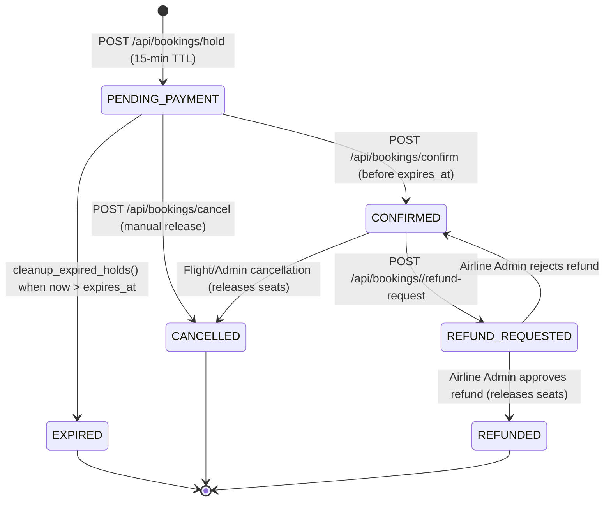
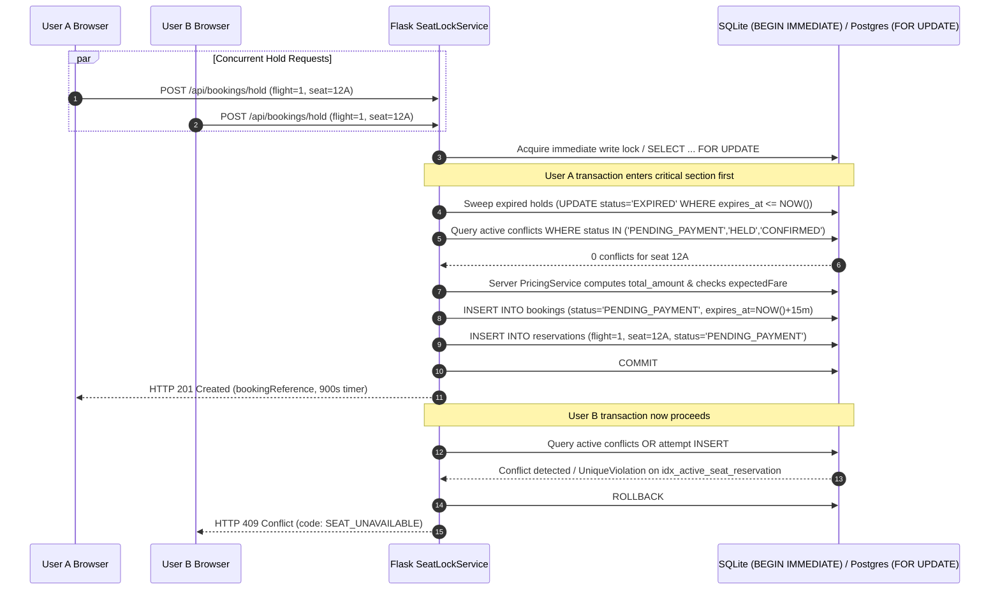

# FLY — Complete Flight Booking Lifecycle & Seat Concurrency Flow

**Based On:** `PROJECT_AUDIT.md`, `DATABASE_DESIGN.md`, `API_SPECIFICATION.md`  
**Core Invariant:** The database is the ultimate authority for seat availability, pricing, and reservation state.

---

## 1. End-to-End Customer Booking Journey (6 Steps)

```text
[1. Home / Search] (/ & /flights/search)
   │  User selects tripType, origin, destination, dates, pax counts, cabin
   │  Frontend queries GET /api/airports/search & GET /api/flights
   ▼
[2. Offer Selection & Details] (/flights/offer/<flight_id>)
   │  Frontend fetches GET /api/flights/<id> + GET /api/flights/fare-breakdown
   │  Displays segments, transit info, baggage rules, refund policy, live fare
   ▼
[3. Traveller Details] (/booking/travellers)
   │  Collects adult/child/infant names, DOB, nationality, passport/NID, contact
   │  Stores non-sensitive draft in sessionStorage (tab-scoped) for next step
   ▼
[4. Extras & Interactive Seat Map] (/booking/extras)
   │  Fetches live seat availability via GET /api/flights/<id>/seats
   │  (And return flight seats if roundtrip)
   │  User picks seats + checked baggage / meal / insurance options
   ▼
[5. Review & Atomic Seat Lock] (/booking/review)
   │  Calls POST /api/bookings/validate (checks seat conflicts + fare drift)
   │  On "Proceed to Payment" (requires login): calls POST /api/bookings/hold
   │  Backend executes atomic transaction -> locks seats for 15 minutes
   ▼
[6. Payment & E-Ticket Issuance] (/booking/payment -> /booking/status/<ref>)
      Live countdown synced to server expires_at
      Submits POST /api/bookings/confirm -> verifies non-expiry & ownership
      Marks booking CONFIRMED, generates PNR + 13-digit e-ticket(s)
      Renders live boarding pass via GET /api/reservations/ticket/<ref>
```

---

## 2. Booking & Reservation State Machine



### Seat Availability Mapping (`reservations.status` -> UI Seat Status)
| Database `reservations.status` | Condition | Seat Map Display | Blocked in `idx_active_seat_reservation`? |
| :--- | :--- | :--- | :--- |
| *(none)* or `EXPIRED` / `CANCELLED` | — | `AVAILABLE` | **No** (seat can be booked again) |
| `PENDING_PAYMENT` or `HELD` | `expires_at > NOW()` | `HELD` (`isHeldByMe` if `id_account == current_user`) | **Yes** |
| `PENDING_PAYMENT` or `HELD` | `expires_at <= NOW()` | Auto-transitioned to `EXPIRED` -> `AVAILABLE` | Released immediately before checks |
| `CONFIRMED` | — | `BOOKED` | **Yes** |

---

## 3. Atomic Seat-Locking Transaction Sequence (Double-Booking Prevention)

When two users click **"Proceed to Payment"** on Seat `12A` of Flight `BG-101` at the exact same millisecond:



### Key Safeguards Enforced
1. **Uniqueness at Storage Layer:** `idx_active_seat_reservation` covers `WHERE status IN ('PENDING_PAYMENT', 'HELD', 'CONFIRMED')`, fixing the prior audit bug where `'PENDING_PAYMENT'` escaped the unique index.
2. **No Read-Then-Write Race:** SQLite uses `BEGIN IMMEDIATE`; PostgreSQL uses `SELECT id FROM flights WHERE id = %s FOR UPDATE` plus `UniqueViolation` (`23505`) handling.
3. **Same-User Re-Hold Idempotency:** If User A clicks Back and re-holds the same seat while still holding it, User A's prior unconfirmed `PENDING_PAYMENT` hold for that session/flight is either reused or cleanly expired/cancelled before inserting the new hold, preventing self-conflict.
4. **Multi-Leg & Round-Trip Atomicity:** All legs (`id_flight`, `return_flight_id`, multi-city segments) validate and insert their seat reservations inside the **same single database transaction** — all legs succeed or all roll back together.

---

## 4. Fare Revalidation & Price Drift Protocol

1. At Review (`/booking/review`), frontend passes `expectedTotal` / `expectedFare` to `/api/bookings/validate` and `/api/bookings/hold`.
2. Backend recalculates authoritative `totalPayable` from `flights` base cabin price + taxes (15% VAT + ৳500 airport tax) + carrier surcharge (৳300) + baggage/extras.
3. If `abs(expectedFare - serverTotal) > 1.0`, backend rejects hold creation with `code: "FARE_CHANGED"` and returns the fresh `fareBreakdown`, forcing explicit user acknowledgment on the UI before re-attempting the hold.

---

## 5. Payment Confirmation & Ticket Issuance Flow

1. User triggers `POST /api/bookings/confirm` from `/booking/payment` or `/my-bookings` (pending hold resume).
2. **Idempotency:** If `bookings.status == 'CONFIRMED'`, returns `200 OK` with `alreadyConfirmed: true` and existing `ticket` without double-charging or duplicating tickets.
3. **Expiration Guard:** If `bookings.status == 'EXPIRED'` or `expires_at <= NOW()`, marks both `bookings` and `reservations` as `EXPIRED`, commits, and returns `410 GONE` (`RESERVATION_EXPIRED`).
4. **Confirmation & Ticketing:** Within the same atomic transaction:
   - Updates `bookings`: `status = 'CONFIRMED'`, generates unique 6-char `pnr_code` (e.g. `FLY8K2`), sets `payment_ref`, `payment_method`, `paid_at`.
   - Updates `reservations`: `status = 'CONFIRMED'`, sets `payment_ref`.
   - Inserts one row per passenger per flight leg into `tickets` with a unique 13-digit IATA-style e-ticket number (e.g. `997-2611000412`).
5. **Post-Booking Manage & Cancellation:**
   - Guests retrieve itineraries via `POST /api/bookings/lookup` (`reference/PNR + lastName`).
   - Confirmed trips can submit a refund/cancellation request via `POST /api/bookings/<ref>/refund-request`, processed by the owning airline's admin in `/admin`.
