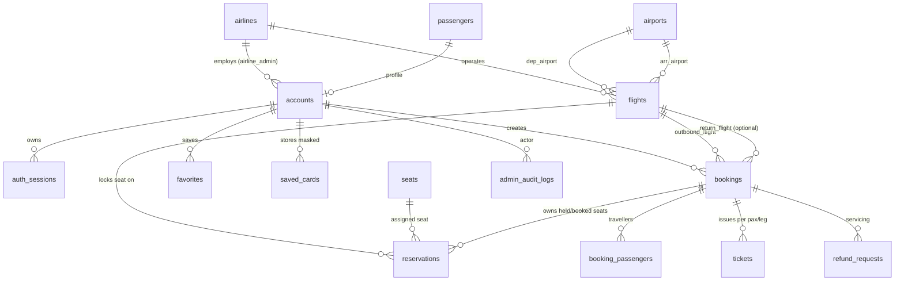

# FLY — Finalized Database Design (PostgreSQL Target & SQLite Parity)

**Based On:** `PROJECT_AUDIT.md` (Section 4)  
**Production Target:** PostgreSQL 16+ (`DATABASE_URL` in `.env`)  
**Local Dev Parity:** SQLite 3 (WAL mode, `database/flight_booking.db`)

---

## 1. Entity-Relationship Overview



---

## 2. Migration Fixes Required Over Current SQLite Schema

From `PROJECT_AUDIT.md`, the current `database/flight_booking.db` has critical defects that this finalized design resolves:
1. **Double-Booking Index Fix:** `idx_active_seat_reservation` previously checked `WHERE status IN ('HELD', 'CONFIRMED')`, omitting `'PENDING_PAYMENT'`. Finalized partial unique index strictly covers `WHERE status IN ('PENDING_PAYMENT', 'HELD', 'CONFIRMED')`.
2. **Explicit Transactions:** PostgreSQL uses `SELECT ... FOR UPDATE` on target seat/flight rows + partial unique index enforcement; SQLite dev parity uses `BEGIN IMMEDIATE`.
3. **Missing Performance Indexes:** Added composite indexes on `flights(dep_airport, arr_airport, dep_datetime)`, `flights(id_airline)`, `airports(iata)`, `airports(city)`, `bookings(id_flight)`, and `bookings(pnr_code)`.
4. **Password & Role Integrity:** Migrate all `1,979` legacy non-`scrypt` passwords, normalize the `978` airline-linked accounts currently marked `PASSENGER`, and enforce `CHECK (role IN ('PASSENGER', 'AIRLINE_ADMIN', 'SUPER_ADMIN'))`.
5. **PCI-DSS Card Hygiene:** Replace raw `creditCards(cardNumber, CVV)` columns with tokenized/masked `saved_cards(card_brand, last4, exp_month, exp_year, card_holder, gateway_token)` — **never storing CVV or full PAN**.
6. **Multi-Leg & Ticket Normalization:** Add `booking_passengers`, `tickets` (13-digit IATA-style e-ticket numbers + PNR), `refund_requests`, and `admin_audit_logs`.

---

## 3. Finalized PostgreSQL DDL Specification

### 3.1 Core Identity & Access Tables

```sql
CREATE TABLE airlines (
    id              BIGSERIAL PRIMARY KEY,
    name            VARCHAR(180) NOT NULL,
    iata            VARCHAR(8) NOT NULL,
    icao            VARCHAR(8),
    logo_url        TEXT,
    logo_blob       BYTEA,
    is_active       BOOLEAN NOT NULL DEFAULT TRUE,
    created_at      TIMESTAMPTZ NOT NULL DEFAULT NOW()
);
CREATE INDEX idx_airlines_iata ON airlines (UPPER(iata));

CREATE TABLE passengers (
    id              BIGSERIAL PRIMARY KEY,
    first_name      VARCHAR(100) NOT NULL,
    last_name       VARCHAR(100) NOT NULL,
    birth_date      DATE,
    gender          VARCHAR(20),
    country         VARCHAR(100) DEFAULT 'Bangladesh',
    phone           VARCHAR(40),
    passport_masked VARCHAR(32),
    profile_picture BYTEA,
    created_at      TIMESTAMPTZ NOT NULL DEFAULT NOW()
);

CREATE TABLE accounts (
    id              BIGSERIAL PRIMARY KEY,
    id_passenger    BIGINT REFERENCES passengers(id) ON DELETE SET NULL,
    id_airline      BIGINT REFERENCES airlines(id) ON DELETE SET NULL,
    username        VARCHAR(100) NOT NULL,
    password_hash   TEXT NOT NULL,
    email_address   VARCHAR(255),
    role            VARCHAR(20) NOT NULL DEFAULT 'PASSENGER'
                    CHECK (role IN ('PASSENGER', 'AIRLINE_ADMIN', 'SUPER_ADMIN')),
    display_name    VARCHAR(180),
    location        VARCHAR(180) DEFAULT 'Dhaka, Bangladesh',
    is_active       BOOLEAN NOT NULL DEFAULT TRUE,
    created_at      TIMESTAMPTZ NOT NULL DEFAULT NOW(),
    updated_at      TIMESTAMPTZ NOT NULL DEFAULT NOW(),
    CONSTRAINT chk_airline_admin_has_airline
        CHECK (role <> 'AIRLINE_ADMIN' OR id_airline IS NOT NULL)
);
CREATE UNIQUE INDEX uq_accounts_username_ci ON accounts (LOWER(username));
CREATE UNIQUE INDEX uq_accounts_email_ci ON accounts (LOWER(email_address)) WHERE email_address IS NOT NULL;
CREATE INDEX idx_accounts_airline ON accounts (id_airline) WHERE id_airline IS NOT NULL;

CREATE TABLE auth_sessions (
    token           VARCHAR(128) PRIMARY KEY,
    account_id      BIGINT NOT NULL REFERENCES accounts(id) ON DELETE CASCADE,
    username        VARCHAR(100) NOT NULL,
    role            VARCHAR(20) NOT NULL,
    airline_id      BIGINT REFERENCES airlines(id) ON DELETE CASCADE,
    ip_address      VARCHAR(64),
    user_agent      TEXT,
    created_at      TIMESTAMPTZ NOT NULL DEFAULT NOW(),
    expires_at      TIMESTAMPTZ NOT NULL
);
CREATE INDEX idx_sessions_account ON auth_sessions (account_id);
CREATE INDEX idx_sessions_expires ON auth_sessions (expires_at);
```

### 3.2 Airports, Flights & Seat Inventory Tables

```sql
CREATE TABLE airports (
    id              BIGSERIAL PRIMARY KEY,
    name            VARCHAR(220) NOT NULL,
    type            VARCHAR(60),
    iata            VARCHAR(8),
    icao            VARCHAR(8),
    city            VARCHAR(120),
    country         VARCHAR(120),
    iso_country     VARCHAR(8)
);
CREATE INDEX idx_airports_iata ON airports (UPPER(iata));
CREATE INDEX idx_airports_city ON airports (LOWER(city));
CREATE INDEX idx_airports_country ON airports (LOWER(country));

CREATE TABLE flights (
    id              BIGSERIAL PRIMARY KEY,
    id_airline      BIGINT NOT NULL REFERENCES airlines(id) ON DELETE CASCADE,
    flight_number   VARCHAR(20),
    dep_airport     BIGINT NOT NULL REFERENCES airports(id),
    arr_airport     BIGINT NOT NULL REFERENCES airports(id),
    dep_datetime    TIMESTAMPTZ NOT NULL,
    arr_datetime    TIMESTAMPTZ NOT NULL,
    aircraft_model  VARCHAR(100),
    stops           SMALLINT NOT NULL DEFAULT 0 CHECK (stops >= 0),
    status          VARCHAR(24) NOT NULL DEFAULT 'SCHEDULED'
                    CHECK (status IN ('SCHEDULED', 'BOARDING', 'DELAYED', 'CANCELLED', 'DEPARTED', 'ARRIVED')),
    first_price     NUMERIC(12,2) NOT NULL DEFAULT 0 CHECK (first_price >= 0),
    business_price  NUMERIC(12,2) NOT NULL DEFAULT 0 CHECK (business_price >= 0),
    economy_price   NUMERIC(12,2) NOT NULL CHECK (economy_price > 0),
    luggage_price   NUMERIC(12,2) NOT NULL DEFAULT 350.00 CHECK (luggage_price >= 0),
    weight_price    NUMERIC(12,2) NOT NULL DEFAULT 120.00 CHECK (weight_price >= 0),
    created_at      TIMESTAMPTZ NOT NULL DEFAULT NOW(),
    CONSTRAINT chk_flight_route_distinct CHECK (dep_airport <> arr_airport),
    CONSTRAINT chk_flight_times_valid CHECK (arr_datetime > dep_datetime)
);
CREATE INDEX idx_flights_route_dep ON flights (dep_airport, arr_airport, dep_datetime);
CREATE INDEX idx_flights_airline ON flights (id_airline, dep_datetime DESC);
CREATE INDEX idx_flights_dep_time ON flights (dep_datetime);

CREATE TABLE seats (
    id              BIGSERIAL PRIMARY KEY,
    seat_column     VARCHAR(4) NOT NULL,
    seat_row        SMALLINT NOT NULL CHECK (seat_row > 0),
    cabin_type      VARCHAR(24) NOT NULL
                    CHECK (cabin_type IN ('Economy', 'Premium Economy', 'Business', 'First', 'first', 'business', 'economy')),
    CONSTRAINT uq_seat_position UNIQUE (seat_row, seat_column)
);
```

### 3.3 Bookings, Reservations (Seat Locks), Travellers & Tickets

```sql
CREATE TABLE bookings (
    id                  BIGSERIAL PRIMARY KEY,
    booking_reference   VARCHAR(40) UNIQUE NOT NULL,
    pnr_code            VARCHAR(10) UNIQUE,
    id_account          BIGINT NOT NULL REFERENCES accounts(id) ON DELETE RESTRICT,
    id_flight           BIGINT NOT NULL REFERENCES flights(id) ON DELETE RESTRICT,
    return_flight_id    BIGINT REFERENCES flights(id) ON DELETE RESTRICT,
    trip_type           VARCHAR(24) NOT NULL DEFAULT 'one_way'
                        CHECK (trip_type IN ('one_way', 'roundtrip', 'multicity')),
    cabin_class         VARCHAR(24) NOT NULL DEFAULT 'Economy',
    status              VARCHAR(24) NOT NULL
                        CHECK (status IN ('PENDING_PAYMENT', 'CONFIRMED', 'EXPIRED', 'CANCELLED', 'REFUND_REQUESTED', 'REFUNDED')),
    total_amount        NUMERIC(12,2) NOT NULL CHECK (total_amount >= 0),
    currency            VARCHAR(8) NOT NULL DEFAULT 'BDT',
    nbr_luggages        INTEGER NOT NULL DEFAULT 0 CHECK (nbr_luggages >= 0),
    weight              NUMERIC(8,2) NOT NULL DEFAULT 0 CHECK (weight >= 0),
    contact_email       VARCHAR(255),
    contact_phone       VARCHAR(40),
    fare_breakdown      JSONB,
    multi_leg_data      JSONB,
    payment_ref         VARCHAR(80),
    payment_method      VARCHAR(40),
    paid_at             TIMESTAMPTZ,
    cancelled_at        TIMESTAMPTZ,
    cancellation_reason TEXT,
    created_at          TIMESTAMPTZ NOT NULL DEFAULT NOW(),
    expires_at          TIMESTAMPTZ NOT NULL,
    updated_at          TIMESTAMPTZ NOT NULL DEFAULT NOW()
);
CREATE INDEX idx_bookings_account ON bookings (id_account, created_at DESC);
CREATE INDEX idx_bookings_flight ON bookings (id_flight, status);
CREATE INDEX idx_bookings_status_expires ON bookings (status, expires_at);
CREATE INDEX idx_bookings_pnr ON bookings (UPPER(pnr_code)) WHERE pnr_code IS NOT NULL;

CREATE TABLE reservations (
    id                  BIGSERIAL PRIMARY KEY,
    booking_reference   VARCHAR(40) NOT NULL REFERENCES bookings(booking_reference) ON DELETE CASCADE,
    id_flight           BIGINT NOT NULL REFERENCES flights(id) ON DELETE CASCADE,
    id_account          BIGINT NOT NULL REFERENCES accounts(id) ON DELETE RESTRICT,
    id_seat             BIGINT NOT NULL REFERENCES seats(id) ON DELETE RESTRICT,
    status              VARCHAR(24) NOT NULL
                        CHECK (status IN ('PENDING_PAYMENT', 'HELD', 'CONFIRMED', 'EXPIRED', 'CANCELLED')),
    nbr_luggages        INTEGER NOT NULL DEFAULT 0,
    weight              NUMERIC(8,2) NOT NULL DEFAULT 0,
    total_price         NUMERIC(12,2) NOT NULL DEFAULT 0,
    payment_ref         VARCHAR(80),
    created_at          TIMESTAMPTZ NOT NULL DEFAULT NOW(),
    expires_at          TIMESTAMPTZ NOT NULL
);

-- CRITICAL DOUBLE-BOOKING GUARD: Only ONE active row per (flight, seat) across hold + confirmed states
CREATE UNIQUE INDEX idx_active_seat_reservation
    ON reservations (id_flight, id_seat)
    WHERE status IN ('PENDING_PAYMENT', 'HELD', 'CONFIRMED');

CREATE INDEX idx_res_flight_status ON reservations (id_flight, status);
CREATE INDEX idx_res_booking_ref ON reservations (booking_reference);
CREATE INDEX idx_res_status_expires ON reservations (status, expires_at);

CREATE TABLE booking_passengers (
    id                  BIGSERIAL PRIMARY KEY,
    booking_reference   VARCHAR(40) NOT NULL REFERENCES bookings(booking_reference) ON DELETE CASCADE,
    passenger_type      VARCHAR(16) NOT NULL CHECK (passenger_type IN ('adult', 'child', 'infant')),
    title               VARCHAR(16),
    first_name          VARCHAR(100) NOT NULL,
    last_name           VARCHAR(100) NOT NULL,
    date_of_birth       DATE,
    nationality         VARCHAR(64),
    gender              VARCHAR(20),
    document_type       VARCHAR(24) DEFAULT 'passport',
    document_last4      VARCHAR(16),
    document_expiry     DATE,
    assigned_seat_id    BIGINT REFERENCES seats(id)
);
CREATE INDEX idx_booking_pax_ref ON booking_passengers (booking_reference);
CREATE INDEX idx_booking_pax_lastname ON booking_passengers (LOWER(last_name));

CREATE TABLE tickets (
    id                  BIGSERIAL PRIMARY KEY,
    ticket_number       VARCHAR(24) UNIQUE NOT NULL,
    booking_reference   VARCHAR(40) NOT NULL REFERENCES bookings(booking_reference) ON DELETE CASCADE,
    passenger_id        BIGINT REFERENCES booking_passengers(id) ON DELETE SET NULL,
    id_flight           BIGINT NOT NULL REFERENCES flights(id) ON DELETE RESTRICT,
    id_airline          BIGINT NOT NULL REFERENCES airlines(id) ON DELETE RESTRICT,
    pnr_code            VARCHAR(10) NOT NULL,
    seat_code           VARCHAR(8),
    cabin_class         VARCHAR(24) NOT NULL,
    status              VARCHAR(24) NOT NULL DEFAULT 'ISSUED'
                        CHECK (status IN ('ISSUED', 'VOID', 'REFUNDED', 'USED')),
    issued_at           TIMESTAMPTZ NOT NULL DEFAULT NOW()
);
CREATE INDEX idx_tickets_booking_ref ON tickets (booking_reference);
CREATE INDEX idx_tickets_airline ON tickets (id_airline, issued_at DESC);
```

### 3.4 Customer Preferences, Refunds & Audit Compliance

```sql
CREATE TABLE favorites (
    id              BIGSERIAL PRIMARY KEY,
    id_account      BIGINT NOT NULL REFERENCES accounts(id) ON DELETE CASCADE,
    id_flight       BIGINT NOT NULL REFERENCES flights(id) ON DELETE CASCADE,
    created_at      TIMESTAMPTZ NOT NULL DEFAULT NOW(),
    CONSTRAINT uq_favorites_account_flight UNIQUE (id_account, id_flight)
);

-- PCI-DSS Safe Replacement for legacy creditCards table (NEVER stores CVV or full PAN)
CREATE TABLE saved_cards (
    id              BIGSERIAL PRIMARY KEY,
    id_account      BIGINT NOT NULL REFERENCES accounts(id) ON DELETE CASCADE,
    card_holder     VARCHAR(140) NOT NULL,
    card_brand      VARCHAR(32) NOT NULL DEFAULT 'VISA',
    last4           CHAR(4) NOT NULL,
    exp_month       SMALLINT NOT NULL CHECK (exp_month BETWEEN 1 AND 12),
    exp_year        SMALLINT NOT NULL CHECK (exp_year >= 2024),
    gateway_token   VARCHAR(128),
    created_at      TIMESTAMPTZ NOT NULL DEFAULT NOW()
);
CREATE INDEX idx_saved_cards_account ON saved_cards (id_account);

CREATE TABLE refund_requests (
    id                  BIGSERIAL PRIMARY KEY,
    booking_reference   VARCHAR(40) NOT NULL REFERENCES bookings(booking_reference) ON DELETE CASCADE,
    id_account          BIGINT NOT NULL REFERENCES accounts(id) ON DELETE RESTRICT,
    id_airline          BIGINT NOT NULL REFERENCES airlines(id) ON DELETE RESTRICT,
    reason              TEXT NOT NULL,
    requested_amount    NUMERIC(12,2) NOT NULL CHECK (requested_amount >= 0),
    approved_amount     NUMERIC(12,2) CHECK (approved_amount >= 0),
    status              VARCHAR(24) NOT NULL DEFAULT 'PENDING'
                        CHECK (status IN ('PENDING', 'APPROVED', 'REJECTED', 'DISBURSED')),
    reviewed_by         BIGINT REFERENCES accounts(id) ON DELETE SET NULL,
    review_note         TEXT,
    created_at          TIMESTAMPTZ NOT NULL DEFAULT NOW(),
    updated_at          TIMESTAMPTZ NOT NULL DEFAULT NOW()
);
CREATE INDEX idx_refunds_airline_status ON refund_requests (id_airline, status);
CREATE INDEX idx_refunds_booking ON refund_requests (booking_reference);

CREATE TABLE admin_audit_logs (
    id              BIGSERIAL PRIMARY KEY,
    actor_id        BIGINT NOT NULL REFERENCES accounts(id) ON DELETE RESTRICT,
    actor_role      VARCHAR(24) NOT NULL,
    airline_id      BIGINT REFERENCES airlines(id) ON DELETE SET NULL,
    action          VARCHAR(80) NOT NULL,
    entity_type     VARCHAR(40) NOT NULL,
    entity_id       VARCHAR(80) NOT NULL,
    reason          TEXT,
    metadata        JSONB,
    ip_address      VARCHAR(64),
    created_at      TIMESTAMPTZ NOT NULL DEFAULT NOW()
);
CREATE INDEX idx_audit_airline_time ON admin_audit_logs (airline_id, created_at DESC);
CREATE INDEX idx_audit_actor_time ON admin_audit_logs (actor_id, created_at DESC);
```

---

## 4. Concurrency & Airline Isolation Rules at Database Level

1. **Seat Lock Authority:** `idx_active_seat_reservation` guarantees at the storage engine level that two transactions cannot both hold or confirm the same `(id_flight, id_seat)` simultaneously, regardless of application-layer timing.
2. **PostgreSQL Row Locking Sequence:** During `hold_seats_atomic`, lock expired holds first or sweep expired rows with `UPDATE ... WHERE status = 'PENDING_PAYMENT' AND expires_at <= NOW()`, lock target `flights` row (`SELECT id FROM flights WHERE id = %s FOR UPDATE`), check active `reservations` for target `seat_ids`, insert `bookings` + `reservations`, and commit. If `UniqueViolation` (`23505`) occurs, roll back and return HTTP `409 SEAT_UNAVAILABLE`.
3. **SQLite Parity Mapping:** In local SQLite (`database/flight_booking.db`), legacy table names (`airLines`, `emailAddress`, `column`, `row`) stay mapped cleanly via views or column-preserving migrations until full PostgreSQL cutover, while `idx_active_seat_reservation` is immediately rebuilt to include `'PENDING_PAYMENT'` and `hold_seats_atomic` uses `BEGIN IMMEDIATE`.
4. **Airline Tenant Isolation:** Every table holding airline-owned data (`flights`, `tickets`, `refund_requests`, `admin_audit_logs`, and `bookings` via `flights.id_airline`) links directly to `airlines(id)`. Queries by `AIRLINE_ADMIN` always join/filter on `id_airline = :session_airline_id`.
