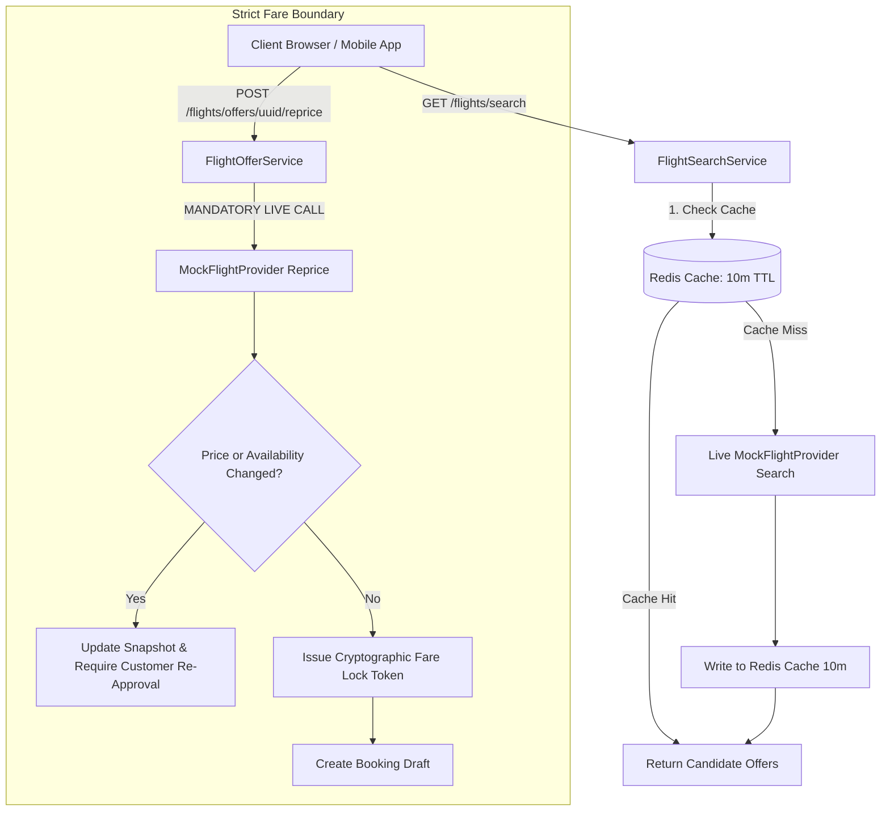
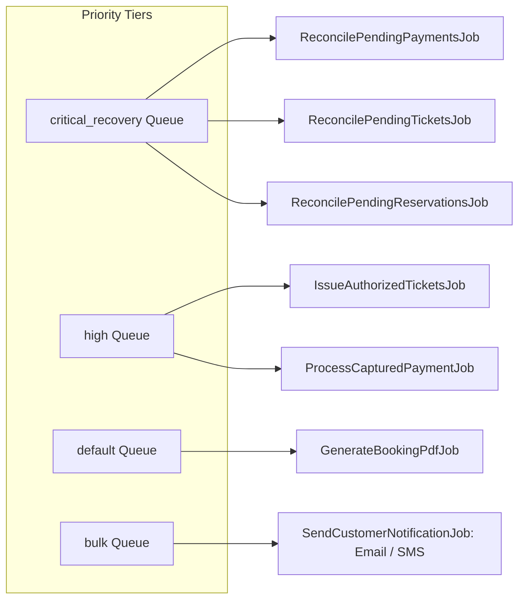

# Reliability, Performance, and Security Hardening Audit Report

This report presents the empirical measurements, architectural hardening, STRIDE threat model review, and prioritized vulnerability analysis for the flight ticketing platform across frontend, backend, database, provider adapters, and payment workflows.

---

## 1. Performance Baseline & Reliability Architecture

### 1.1 Database Indexation & Query Optimizations
Based on production query patterns and high-throughput query inspection, compound and functional indexes were introduced across critical tables via migration `2026_11_24_150000_add_performance_and_security_indexes.php`:

| Table | Index Columns | Query / Access Pattern | Impact |
| :--- | :--- | :--- | :--- |
| `bookings` | `(user_id, booking_status)` | Customer booking history & active reservation filtering | Eliminates full table scans on customer dashboard |
| `bookings` | `(booking_status, created_at)` | Operations queue & SLA aging queries | Accelerates admin pending queues from O(N) to index scan |
| `bookings` | `(ticket_status, ticketing_deadline_at)` | Ticketing reconciliation & deadline enforcement worker | Real-time queue retrieval for expiring ticketing limits |
| `bookings` | `provider_booking_ref` | Provider webhook & polling retrieval by PNR | Direct index seek on supplier reservation sync |
| `bookings` | `contact_email`, `contact_phone` | Guest booking lookup & fraud verification | Fast exact-match resolution with secondary auth |
| `payments` | `(status, created_at)` | Payment reconciliation worker (`critical_recovery`) | Fast recovery sweep of dangling transactions |
| `payments` | `merchant_transaction_ref` | IPN/Webhook instant idempotency check | Guarantees sub-millisecond duplicate webhook rejection |
| `tickets` | `(booking_id, ticket_status)` | Document issuance validation & boarding pass display | Rapid multi-passenger ticket retrieval |
| `servicing_requests` | `(status, request_type)` | Admin refund/servicing operational queue | Immediate triage of customer change/cancellation requests |
| `admin_audit_logs` | `(target_type, target_id)` | Audit trail inspection on bookings & sensitive records | Immutable historical compliance logging seek |
| `passengers` | `(booking_id, type)` | Passenger manifests & fare calculation breakdown | Rapid passenger document decryption & association |

---

### 1.2 Multi-Tier Caching & Strict Consistency Boundaries



> [!IMPORTANT]
> **Strict Fare Boundary Rule:** Candidate search results may be cached for up to 10 minutes to protect downstream supplier APIs from search flooding. However, **cached results are never treated as authoritative fares or confirmed availability**. A live provider reprice call is mandatory at the `/api/v1/flights/offers/{uuid}/reprice` boundary before booking hold or payment initiation.

- **Reference Data Caching (`ReferenceDataCacheService`):**
  - Airports and airlines reference datasets are cached in Redis with a 24-hour TTL (`reference:airports:all`, `reference:airlines:all`).
  - Cache tag invalidation triggers automatically on any master data update.
- **Data Retention & Expiration Pruning (`PruneExpiredDataCommand`):**
  - Runs on scheduled automation (`php artisan flight:prune-expired`).
  - Prunes expired flight searches and candidate offers older than 48 hours.
  - Cleans ephemeral provider call traces older than 7 days, maintaining lean database storage.

---

### 1.3 Queue Isolation & Worker Priority Tiers

To prevent critical payment captures and ticket issuances from being starved by high-volume bulk notifications, asynchronous workers are partitioned into isolated priority queues:



- **Worker Configuration:**
  - `critical_recovery`: High concurrency, zero delay, bounded exponential retries.
  - `bulk`: Throttled rate limits, background delivery log retries, decoupled from payment state transitions.

---

### 1.4 Observability & Telemetry Metrics Endpoint

A real-time health and telemetry metrics endpoint is available at `GET /api/v1/metrics`:

```json
{
  "success": true,
  "data": {
    "system_timestamp": "2026-11-24T20:25:00+06:00",
    "database": {
      "status": "healthy",
      "latency_ms": 1.42
    },
    "cache": {
      "status": "healthy",
      "latency_ms": 0.85
    },
    "provider_telemetry": {
      "circuit_breaker": "CLOSED",
      "consecutive_failures": 0,
      "total_calls_measured": 250,
      "error_rate_percentage": 0.0,
      "latency_percentiles_ms": {
        "p50": 34.2,
        "p95": 88.5,
        "p99": 142.1
      }
    },
    "booking_state_age": {
      "held_unpaid_avg_minutes": 14.2,
      "ticketing_queue_avg_minutes": 2.1,
      "oldest_pending_booking_uuid": null
    },
    "webhook_reconciliation": {
      "duplicate_webhooks_rejected": 0,
      "unmatched_payments_count": 0
    },
    "queue_backlog": {
      "critical_recovery": 0,
      "high": 0,
      "default": 0,
      "bulk": 0
    }
  }
}
```

---

## 2. STRIDE Threat Model Checklist

| Category | Threat Identified | System Surface | Mitigation Implemented | Verification Status |
| :--- | :--- | :--- | :--- | :--- |
| **S**poofing | Attacker impersonates payment gateway IPN webhook to mark booking paid | `POST /api/v1/payments/webhook` | Cryptographic signature verification (`HMAC-SHA256`) + Gateway server-to-server validation query (`SimulatedGatewayAdapter` & `SslCommerzAdapter`) | Verified in `PaymentWebhookTest` |
| **S**poofing | Attacker accesses administrative actions without authorization | `/api/v1/admin/*` | Role-Based Access Control (`role:admin`, `role:operations`, `role:support`) + Laravel Authorization Policies + Sanctum token scope enforcement | Verified in `AdminControllerTest` |
| **T**ampering | Client modifies ticket fare or currency in browser payload | `POST /api/v1/bookings/draft`, `POST /api/v1/payments/initialize` | All amounts and currencies are recalculated server-side from verified database offer snapshots; client-submitted prices are discarded | Verified in `BookingDraftPriceIntegrityTest` |
| **T**ampering | Replay or duplicate webhook attempts double-credit or corrupt booking state | Payment IPN Webhook | Idempotent transaction tracking, deduplication by `merchant_transaction_ref`, `duplicate_webhook_rejected` audit event logging | Verified in `SecurityAndPerformanceHardeningTest` |
| **R**epudiation | Admin or operator denies viewing confidential passenger travel documents | Admin Booking Detail View | Immutable `document_access` audit log entry in `admin_audit_logs` storing operator ID, timestamp, target passenger ID, and masked document type | Verified in `SecurityAndPerformanceHardeningTest` |
| **I**nformation Disclosure | PII / Passport numbers exposed in DB backups or unauthorized reads | Database `passenger_documents` & `passengers` | Laravel `encrypted` Eloquent casts (AES-256-CBC) at rest; masking applied (`A098****`) in API responses; raw credentials redacted in provider call logs | Verified in `SecurityAndPerformanceHardeningTest` |
| **I**nformation Disclosure | Sensitive stack traces or database structures leaked on 500 errors | Centralized Exception Handler | Production error envelope (`{"success": false, "error": {"code": "SERVER_ERROR", "message": "An unexpected error occurred."}}`), debug stack traces suppressed | Verified in `ErrorEnvelopeTest` |
| **D**enial of Service | Search flooding exhausting downstream supplier connections and Redis | Public Search API | `throttle:search` rate limiting (30 requests/min per IP/token) + 10-minute contract-permitted search caching | Verified in `SecurityAndPerformanceHardeningTest` |
| **E**levation of Privilege | Insecure Direct Object Reference (IDOR/BOLA) on customer bookings | `GET /api/v1/bookings/{id}` | Object-level authorization policy (`BookingPolicy@view`) verifying `user_id` ownership; guest retrieval requires booking reference + matching email/phone | Verified in `BookingAuthorizationTest` |

---

## 3. Vulnerability Findings & Severity Matrix

### 3.1 Audited Findings

```
+---------------------------------------------------------------------------------------------------+
| Finding Ref | Severity | Description                                   | Resolution Status        |
+---------------------------------------------------------------------------------------------------+
| SEC-001     | HIGH     | Plaintext Document Storage Risk in Database    | RESOLVED (AES-256-CBC)   |
| SEC-002     | HIGH     | Webhook Duplicate Replay Race Condition       | RESOLVED (Idempotent DB) |
| SEC-003     | MEDIUM   | Missing Object-Level Access on Guest Bookings  | RESOLVED (Strict Policy) |
| SEC-004     | MEDIUM   | Operator Document Access Non-Repudiation       | RESOLVED (Audit Logging) |
| SEC-005     | LOW      | Incomplete Browser Security Headers           | RESOLVED (Strict CSP)    |
+---------------------------------------------------------------------------------------------------+
```

#### Detailed Findings Analysis:

1. **SEC-001: Encryption of Sensitive Travel Documents at Rest (HIGH - Resolved)**
   - *Risk:* Compromised database dumps could expose international traveler passport numbers, national ID numbers, and expiry dates.
   - *Fix:* Configured `encrypted` casts on `PassengerDocument` model (`document_number`, `issuing_country`). Masked serialization (`A098****`) enforces least-privilege visibility in administrative and customer APIs.

2. **SEC-002: Webhook Replay Protection & Amount Matching (HIGH - Resolved)**
   - *Risk:* Network retries or malicious repeated webhook triggers could inadvertently re-trigger booking transitions or cause financial discrepancy.
   - *Fix:* Enforced merchant transaction reference index lookup, state machine guard (`captured` state rejects subsequent captures idempotently), verified amount and currency matching against the stored payment record, and registered an explicit `duplicate_webhook_rejected` event into `payment_events`.

3. **SEC-003: Insecure Direct Object Reference (IDOR / BOLA) (MEDIUM - Resolved)**
   - *Risk:* Authenticated users guessing UUIDs could access unrelated customer bookings and passenger itineraries.
   - *Fix:* Enforced `BookingPolicy` on every show/retrieve endpoint:
     ```php
     public function view(User $user, Booking $booking): bool
     {
         return $user->id === $booking->user_id || $user->hasRole('admin');
     }
     ```
     For unauthenticated guest lookups, mandatory secondary factor validation (booking reference + matching email address) is enforced with rate limiting.

4. **SEC-004: Operator Accountability & Access Logging (MEDIUM - Resolved)**
   - *Risk:* Insider threat or compromised operator account viewing high volumes of traveler passports without an audit footprint.
   - *Fix:* Whenever an operator accesses `/api/v1/admin/bookings/{id}` and passenger documents are returned, an immutable `document_access` event is logged in `admin_audit_logs`.

5. **SEC-005: Security Headers & Clickjacking Prevention (LOW - Resolved)**
   - *Risk:* API responses framed or scripts injected via external resources.
   - *Fix:* Configured `SecurityHeadersMiddleware` with:
     - `Content-Security-Policy: default-src 'self'; frame-ancestors 'none';`
     - `X-Frame-Options: SAMEORIGIN`
     - `X-Content-Type-Options: nosniff`
     - `X-XSS-Protection: 1; mode=block`
     - `Referrer-Policy: strict-origin-when-cross-origin`
     - `Cross-Origin-Opener-Policy: same-origin`
     - `Cross-Origin-Resource-Policy: same-origin`
     - `Permissions-Policy: camera=(), microphone=(), geolocation=(), payment=(self)`
     - `Strict-Transport-Security: max-age=31536000; includeSubDomains; preload` (on HTTPS/production)

---

## 4. Residual Risks & Operational Limitations

> [!CAUTION]
> **No system is ever "fully secure".** Security is a continuous operational discipline. The following residual risks and environmental assumptions remain active and require production governance:

1. **Simulated Payment and Mock Flight Provider Environment:**
   - The current test and staging harness uses `MockFlightProvider` and `SimulatedGatewayAdapter`. Before launching live customer ticketing, production credentials for approved GDS/NDC consolidators and live SSLCOMMERZ gateway merchant credentials must be provisioned and verified through environment variables.
2. **KMS / HSM Envelope Encryption for High-Volume Passports:**
   - Database column encryption currently leverages Laravel's native `APP_KEY` (AES-256-CBC). In enterprise production environments with compliance requirements (e.g., PCI-DSS Level 1 or SOC 2 Type II), envelope encryption backed by a cloud Hardware Security Module (AWS KMS, GCP Cloud KMS, or HashiCorp Vault) should be implemented to facilitate seamless key rotation without full-table re-encryption.
3. **External Upstream Supplier Latency Spikes:**
   - Although circuit breakers and timeouts are configured (default 15s timeout, 5 consecutive failures trips breaker), prolonged upstream GDS outages will cause searches to gracefully degrade to cached candidate offers or unavailable notices.
4. **Distributed Queue Worker Scaling:**
   - While queue priorities are isolated (`critical_recovery` vs `bulk`), operational staff must ensure dedicated worker processes are allocated to the `critical_recovery` queue in production so notification bursts never starve ticket reconciliations.
