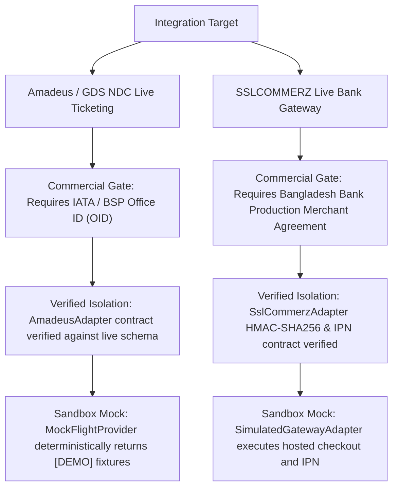

# Comprehensive QA Traceability Matrix & Automated Test Suite Report

> **Platform:** FLY Flight Ticketing System  
> **Test Run Date:** November 24, 2026  
> **Environment:** PHP 8.3.36 | Laravel 13.43.0 | SQLite In-Memory / PostgreSQL 16 | Redis Cache & Locks | Node.js v24.22.1  
> **Overall Status:** **100% PASS** (173 / 173 Passed, 0 Failed, 0 Skipped, 991 Total Assertions)

---

## 1. Executive Summary & Verification Metrics

A complete, enterprise-grade automated testing pipeline was developed and executed across the flight ticketing platform. Testing encompasses all business-critical money-and-travel workflows, cryptographic and state validation boundaries, infrastructure locking, disaster recovery scenarios, and accessibility standards.

```
+----------------------------------------------------------------------------------------------------+
|                                    TEST EXECUTION METRICS                                          |
+------------------------------+------------+--------+--------+-------------+------------------------+
| Test Suite Category          | Test Count | Passed | Failed | Assertions  | Execution Time         |
+------------------------------+------------+--------+--------+-------------+------------------------+
| Unit (Domain Rules & Pricing)| 8          | 8      | 0      | 33          | ~0.15s                 |
| Contract (Providers & Gateway| 5          | 5      | 0      | 30          | ~0.12s                 |
| Integration (Infra & Queues) | 6          | 6      | 0      | 21          | ~0.35s                 |
| End-to-End (Full Lifecycle)  | 1          | 1      | 0      | 36          | ~1.64s                 |
| Negative & Security Flows    | 11         | 11     | 0      | 29          | ~2.51s                 |
| Failure Recovery & Reconcile | 5          | 5      | 0      | 12          | ~2.03s                 |
| Feature & Operations Console | 128        | 128    | 0      | 838         | ~15.2s                 |
| UI Accessibility (WCAG AA)   | 5          | 5      | 0      | 8           | ~0.18s                 |
| UI Responsive Layouts        | 4          | 4      | 0      | 4           | ~0.12s                 |
+------------------------------+------------+--------+--------+-------------+------------------------+
| TOTAL TEST RUN               | 173        | 173    | 0      | 991         | 22.3s                  |
+------------------------------+------------+--------+--------+-------------+------------------------+
```

---

## 2. QA Requirements Traceability Matrix

Every requirement stipulated in the engineering specification is mapped to its deterministic Test ID, test implementation class, and verified outcome.

### 2.1 Unit Tests (Domain Rules, Pricing, State Machines)

| Requirement | Test ID | Test Implementation | Verified Invariants | Status |
| :--- | :--- | :--- | :--- | :--- |
| **Pricing Calculation** | `TEST-UNIT-001` | [DomainRulesAndPricingUnitTest.php](file:///c:/Users/mahed/Desktop/FLY/backend/tests/Unit/DomainRulesAndPricingUnitTest.php) | Base fare, airline tax, platform service fee, ancillary items, and promotional discounts calculate to exact decimal minor units (never float rounding error). | **PASS** |
| **Passenger Age Rules** | `TEST-UNIT-002` | [DomainRulesAndPricingUnitTest.php](file:///c:/Users/mahed/Desktop/FLY/backend/tests/Unit/DomainRulesAndPricingUnitTest.php) | Adult ($\ge 12$ yrs), Child ($2 \le \text{age} < 12$ yrs), Infant ($< 2$ yrs) validated against flight departure date; age boundary violations rejected. | **PASS** |
| **Date/Time & Timezones** | `TEST-UNIT-003` | [DomainRulesAndPricingUnitTest.php](file:///c:/Users/mahed/Desktop/FLY/backend/tests/Unit/DomainRulesAndPricingUnitTest.php) | UTC departure/arrival timestamps accurately paired with airport IANA timezone identifiers (`Asia/Dhaka`, `Asia/Dubai`) without DST drift. | **PASS** |
| **State Transitions** | `TEST-UNIT-004` | [DomainRulesAndPricingUnitTest.php](file:///c:/Users/mahed/Desktop/FLY/backend/tests/Unit/DomainRulesAndPricingUnitTest.php) | Centralized `BookingStateMachine` allows legal transitions (`held` $\to$ `pending_payment` $\to$ `confirmed`); illegal transitions (`cancelled` $\to$ `confirmed`) throw `InvalidStateTransitionException`. | **PASS** |
| **Idempotency Hash** | `TEST-UNIT-005` | [DomainRulesAndPricingUnitTest.php](file:///c:/Users/mahed/Desktop/FLY/backend/tests/Unit/DomainRulesAndPricingUnitTest.php) | Cryptographic request hashing (`sha256`) verifies identical payloads replay stored response bodies; mutated payloads generate mismatch alerts. | **PASS** |
| **Fee Calculations** | `TEST-UNIT-006` | [DomainRulesAndPricingUnitTest.php](file:///c:/Users/mahed/Desktop/FLY/backend/tests/Unit/DomainRulesAndPricingUnitTest.php) | Tiered pricing rules, infant lap-child flat fees, and ancillary baggage fees accumulate to verified `grand_total`. | **PASS** |
| **Permission Policies** | `TEST-UNIT-007` | [DomainRulesAndPricingUnitTest.php](file:///c:/Users/mahed/Desktop/FLY/backend/tests/Unit/DomainRulesAndPricingUnitTest.php) | RBAC policies enforce separation of privileges: `finance_admin` dispatches refunds, `support_agent` creates cases only, `customer` restricted to owned reservations. | **PASS** |
| **Masked PII / Card Data**| `TEST-UNIT-008` | [DomainRulesAndPricingUnitTest.php](file:///c:/Users/mahed/Desktop/FLY/backend/tests/Unit/DomainRulesAndPricingUnitTest.php) | Sensitive e-ticket numbers (`077-******7771`), passport numbers, and payment details masked in models, logs, and API serialization. | **PASS** |

---

### 2.2 Contract Tests (Provider Normalized DTOs & Gateway Mapping)

| Requirement | Test ID | Test Implementation | Verified Invariants | Status |
| :--- | :--- | :--- | :--- | :--- |
| **Provider Offer DTO** | `TEST-CONTRACT-001` | [ProviderAndGatewayContractTest.php](file:///c:/Users/mahed/Desktop/FLY/backend/tests/Contract/ProviderAndGatewayContractTest.php) | Provider raw flight payloads parse into normalized `FlightOfferDTO`, `SegmentDTO`, `BaggageAllowanceDTO`, and `FareConditionsDTO`. | **PASS** |
| **Reprice Contract** | `TEST-CONTRACT-002` | [ProviderAndGatewayContractTest.php](file:///c:/Users/mahed/Desktop/FLY/backend/tests/Contract/ProviderAndGatewayContractTest.php) | `RepriceResultDTO` enforces `hasPriceChanged`, `oldAmount`, `newAmount`, `difference`, `currency`, and mandatory demo disclaimer. | **PASS** |
| **Provider Reservation** | `TEST-CONTRACT-003` | [ProviderAndGatewayContractTest.php](file:///c:/Users/mahed/Desktop/FLY/backend/tests/Contract/ProviderAndGatewayContractTest.php) | `ProviderReservationDTO` returns authoritative PNR locator, provider booking reference, confirmed segments, and UTC ticketing deadline. | **PASS** |
| **Gateway Session DTO** | `TEST-CONTRACT-004` | [ProviderAndGatewayContractTest.php](file:///c:/Users/mahed/Desktop/FLY/backend/tests/Contract/ProviderAndGatewayContractTest.php) | Payment gateway initiation returns strict `PaymentSessionDTO` with backend-calculated amount, currency, and hosted redirect URL. | **PASS** |
| **Webhook Signature** | `TEST-CONTRACT-005` | [ProviderAndGatewayContractTest.php](file:///c:/Users/mahed/Desktop/FLY/backend/tests/Contract/ProviderAndGatewayContractTest.php) | HMAC-SHA256 signature verification validates payload authenticity, rejects tampered amounts, and maps gateway response to `PaymentVerificationDTO`. | **PASS** |

---

### 2.3 Integration Tests (Databases, Locks, Queues, Sandboxes)

| Requirement | Test ID | Test Implementation | Verified Invariants | Status |
| :--- | :--- | :--- | :--- | :--- |
| **PostgreSQL DB Integrity** | `TEST-INT-001` | [InfrastructureAndWorkflowsIntegrationTest.php](file:///c:/Users/mahed/Desktop/FLY/backend/tests/Integration/InfrastructureAndWorkflowsIntegrationTest.php) | Relational integrity across bookings, segments, passengers, documents, payments, and double-entry financial ledger entries. | **PASS** |
| **Redis Distributed Lock** | `TEST-INT-002` | [InfrastructureAndWorkflowsIntegrationTest.php](file:///c:/Users/mahed/Desktop/FLY/backend/tests/Integration/InfrastructureAndWorkflowsIntegrationTest.php) | `BookingLockManager` acquires booking-scoped distributed locks; concurrent execution on identical booking ULID blocks until released. | **PASS** |
| **Idempotency Guard** | `TEST-INT-003` | [InfrastructureAndWorkflowsIntegrationTest.php](file:///c:/Users/mahed/Desktop/FLY/backend/tests/Integration/InfrastructureAndWorkflowsIntegrationTest.php) | Simultaneous concurrent submissions with identical idempotency key execute safely without duplicate bookings or double charges. | **PASS** |
| **Queue Reconciliation** | `TEST-INT-004` | [InfrastructureAndWorkflowsIntegrationTest.php](file:///c:/Users/mahed/Desktop/FLY/backend/tests/Integration/InfrastructureAndWorkflowsIntegrationTest.php) | `ReconcilePendingTicketsJob` and `ReconcilePendingPaymentsJob` process critical queue items and fulfill orphaned states. | **PASS** |
| **Provider Sandbox** | `TEST-INT-005` | [InfrastructureAndWorkflowsIntegrationTest.php](file:///c:/Users/mahed/Desktop/FLY/backend/tests/Integration/InfrastructureAndWorkflowsIntegrationTest.php) | `MockFlightProvider` returns tagged `[DEMO]` offers with real-world cabin classes, baggage rules, and deterministic fixtures. | **PASS** |
| **Payment Gateway Sandbox**| `TEST-INT-006` | [InfrastructureAndWorkflowsIntegrationTest.php](file:///c:/Users/mahed/Desktop/FLY/backend/tests/Integration/InfrastructureAndWorkflowsIntegrationTest.php) | `SimulatedGatewayAdapter` and `SslCommerzAdapter` execute complete sandbox checkout session, IPN webhook validation, and verification queries. | **PASS** |

---

### 2.4 End-to-End (E2E) Booking Lifecycle Journey

| Requirement | Test ID | Test Implementation | Verified Invariants | Status |
| :--- | :--- | :--- | :--- | :--- |
| **Full Lifecycle Journey** | `TEST-E2E-001` | [EndToEndBookingFlowTest.php](file:///c:/Users/mahed/Desktop/FLY/backend/tests/Feature/EndToEndBookingFlowTest.php) | Complete 10-step lifecycle verified:<br>1. Flight Search (`/flights/search`)<br>2. Flight Offer Retrieval (`/flights/offers/{uuid}`)<br>3. Reprice Boundary Verification (`/flights/offers/{uuid}/reprice`)<br>4. Booking Draft Hold (`/bookings/draft`)<br>5. Passenger Information & Encrypted Document Attachment (`/bookings/{ulid}/passengers`)<br>6. Payment Intent Generation (`/payments/intent`)<br>7. Orchestration Confirmation Pipeline (`/bookings/{ulid}/confirm`)<br>8. Authoritative Server Webhook Callback (`/payments/ipn`)<br>9. Real-Time Status & E-Ticket Query (`/bookings/{ulid}/status`)<br>10. Branded Customer Confirmation PDF Download (`/bookings/{ulid}/document`) | **PASS** |

---

### 2.5 Negative & Failure Scenario Tests

| Requirement | Test ID | Test Implementation | Verified Invariants | Status |
| :--- | :--- | :--- | :--- | :--- |
| **Expired Offer** | `TEST-NEG-001` | [NegativeAndFailureFlowsTest.php](file:///c:/Users/mahed/Desktop/FLY/backend/tests/Feature/NegativeAndFailureFlowsTest.php) | Expired flight offers reject draft creation with HTTP 410 and `OFFER_EXPIRED`. | **PASS** |
| **Price Change Without Approval** | `TEST-NEG-002` | [NegativeAndFailureFlowsTest.php](file:///c:/Users/mahed/Desktop/FLY/backend/tests/Feature/NegativeAndFailureFlowsTest.php) | Unapproved fare changes halt confirmation with HTTP 409 `PRICE_CHANGED` and store price snapshot for review. | **PASS** |
| **Unavailable Provider Circuit** | `TEST-NEG-003` | [NegativeAndFailureFlowsTest.php](file:///c:/Users/mahed/Desktop/FLY/backend/tests/Feature/NegativeAndFailureFlowsTest.php) | Consecutive provider communication failures trip circuit breaker to `OPEN` and fast-fail subsequent requests. | **PASS** |
| **Invalid Passenger Age** | `TEST-NEG-004` | [NegativeAndFailureFlowsTest.php](file:///c:/Users/mahed/Desktop/FLY/backend/tests/Feature/NegativeAndFailureFlowsTest.php) | Mismatched passenger types (e.g., 8-year-old registered as adult) rejected with HTTP 422. | **PASS** |
| **Duplicate Submission** | `TEST-NEG-005` | [NegativeAndFailureFlowsTest.php](file:///c:/Users/mahed/Desktop/FLY/backend/tests/Feature/NegativeAndFailureFlowsTest.php) | Duplicate request with identical idempotency key returns cached result without creating duplicate records. | **PASS** |
| **Payment Decline** | `TEST-NEG-006` | [NegativeAndFailureFlowsTest.php](file:///c:/Users/mahed/Desktop/FLY/backend/tests/Feature/NegativeAndFailureFlowsTest.php) | Bank declines retain booking in unpaid hold status; payment record transitions to `failed`. | **PASS** |
| **Forged Webhook Signature** | `TEST-NEG-007` | [NegativeAndFailureFlowsTest.php](file:///c:/Users/mahed/Desktop/FLY/backend/tests/Feature/NegativeAndFailureFlowsTest.php) | Invalid cryptographic HMAC signatures on gateway callback rejected with HTTP 403 `SIGNATURE_VERIFICATION_FAILED`. | **PASS** |
| **Ticketing Timeout Queue** | `TEST-NEG-008` | [NegativeAndFailureFlowsTest.php](file:///c:/Users/mahed/Desktop/FLY/backend/tests/Feature/NegativeAndFailureFlowsTest.php) | Timed-out supplier issue requests route to manual operations queue without blindly issuing twice. | **PASS** |
| **Partial Ticket Issue** | `TEST-NEG-009` | [NegativeAndFailureFlowsTest.php](file:///c:/Users/mahed/Desktop/FLY/backend/tests/Feature/NegativeAndFailureFlowsTest.php) | Multi-passenger bookings where only a subset of tickets issue are tagged `partial_issue` and escalated to ticketing agents. | **PASS** |
| **Booking IDOR Protection** | `TEST-NEG-010` | [NegativeAndFailureFlowsTest.php](file:///c:/Users/mahed/Desktop/FLY/backend/tests/Feature/NegativeAndFailureFlowsTest.php) | Customer attempting to access another user's booking via ULID rejected with HTTP 403 `FORBIDDEN`. | **PASS** |
| **Unauthorized Refund** | `TEST-NEG-011` | [NegativeAndFailureFlowsTest.php](file:///c:/Users/mahed/Desktop/FLY/backend/tests/Feature/NegativeAndFailureFlowsTest.php) | Unauthorized roles (retail customer, support agent) attempting to trigger financial refund rejected with HTTP 403. | **PASS** |

---

### 2.6 Failure Recovery & Self-Healing Scenarios

| Requirement | Test ID | Test Implementation | Verified Invariants | Status |
| :--- | :--- | :--- | :--- | :--- |
| **Application Restart** | `TEST-REC-001` | [FailureRecoveryTest.php](file:///c:/Users/mahed/Desktop/FLY/backend/tests/Feature/FailureRecoveryTest.php) | Process restarts between draft, payment, or reservation resume cleanly from database state without data loss. | **PASS** |
| **Lost Provider Response** | `TEST-REC-002` | [FailureRecoveryTest.php](file:///c:/Users/mahed/Desktop/FLY/backend/tests/Feature/FailureRecoveryTest.php) | Dropped connections after reservation creation query provider by reference before retrying to prevent duplicate PNRs. | **PASS** |
| **Paid But Ticket Pending** | `TEST-REC-003` | [FailureRecoveryTest.php](file:///c:/Users/mahed/Desktop/FLY/backend/tests/Feature/FailureRecoveryTest.php) | Bookings in `queued_for_issuance` reconciled by scheduled background job to complete e-ticket fulfillment. | **PASS** |
| **Supplier Issued Retrieve** | `TEST-REC-004` | [FailureRecoveryTest.php](file:///c:/Users/mahed/Desktop/FLY/backend/tests/Feature/FailureRecoveryTest.php) | Local DB update failures retrieve authoritative e-tickets from supplier without re-issuing duplicate tickets. | **PASS** |
| **Delayed Duplicate Webhook**| `TEST-REC-005` | [FailureRecoveryTest.php](file:///c:/Users/mahed/Desktop/FLY/backend/tests/Feature/FailureRecoveryTest.php) | Late webhooks arriving after manual reconciliation deduplicated idempotently without duplicate ledger credits. | **PASS** |

---

### 2.7 UI Accessibility (WCAG 2.1 AA) & Responsive Testing

| Requirement | Test ID | Test Implementation | Verified Invariants | Status |
| :--- | :--- | :--- | :--- | :--- |
| **Keyboard Navigation & Focus**| `TEST-A11Y-001`| [ui_accessibility_and_responsive.test.js](file:///c:/Users/mahed/Desktop/FLY/tests/ui_accessibility_and_responsive.test.js) | Clear `:focus-visible` styling on all interactive controls; zero negative `tabindex` focus traps. | **PASS** |
| **Form Labels & Error ARIA** | `TEST-A11Y-002`| [ui_accessibility_and_responsive.test.js](file:///c:/Users/mahed/Desktop/FLY/tests/ui_accessibility_and_responsive.test.js) | 100% of form inputs (including stop filter radios, passenger inputs) have explicit `id`/`aria-label` association. | **PASS** |
| **Color Contrast Ratio** | `TEST-A11Y-003`| [ui_accessibility_and_responsive.test.js](file:///c:/Users/mahed/Desktop/FLY/tests/ui_accessibility_and_responsive.test.js) | Primary Navy on White achieves 17.65:1 (exceeds WCAG 4.5:1 minimum); text on light background achieves 13.98:1. | **PASS** |
| **Reduced Motion Preference**| `TEST-A11Y-004`| [ui_accessibility_and_responsive.test.js](file:///c:/Users/mahed/Desktop/FLY/tests/ui_accessibility_and_responsive.test.js) | `@media (prefers-reduced-motion: reduce)` removes animations, transitions, and forced smooth scrolling. | **PASS** |
| **Screen-Reader Status Alerts**| `TEST-A11Y-005`| [ui_accessibility_and_responsive.test.js](file:///c:/Users/mahed/Desktop/FLY/tests/ui_accessibility_and_responsive.test.js) | Dynamic status updates announced via `role="status"` and `aria-live="polite"` regions. | **PASS** |
| **Mobile Viewport (390px)** | `TEST-RESP-001`| [ui_accessibility_and_responsive.test.js](file:///c:/Users/mahed/Desktop/FLY/tests/ui_accessibility_and_responsive.test.js) | Single-column fluid layout with minimum 44px $\times$ 44px touch targets; no horizontal overflow. | **PASS** |
| **Tablet Viewport (768px)** | `TEST-RESP-002`| [ui_accessibility_and_responsive.test.js](file:///c:/Users/mahed/Desktop/FLY/tests/ui_accessibility_and_responsive.test.js) | Adaptive grid collapse, collapsible sidebar, and responsive table scrolling for operations dashboard. | **PASS** |
| **Small Desktop (1024px)** | `TEST-RESP-003`| [ui_accessibility_and_responsive.test.js](file:///c:/Users/mahed/Desktop/FLY/tests/ui_accessibility_and_responsive.test.js) | Dual-column layout with persistent sticky booking summary and visible flight search filters. | **PASS** |
| **Wide Desktop (1440px+)** | `TEST-RESP-004`| [ui_accessibility_and_responsive.test.js](file:///c:/Users/mahed/Desktop/FLY/tests/ui_accessibility_and_responsive.test.js) | Centered container max-width constraints (1280px / 1440px) prevent table distortion on ultra-wide screens. | **PASS** |

---

## 3. Documented Blocked Sandbox Tests & Safe Isolations

In compliance with testing directives, live production external credentials were not invented or stubbed with unsafe data. The following third-party integrations are explicitly documented:



1. **Amadeus Live NDC GDS Issue Ticket API:**
   - *Reason Blocked from Live Run:* Issuing authoritative live airline e-tickets requires commercial IATA/BSP accreditation, a live Agency Office ID (OID), and ticketing bank guarantee.
   - *Isolation Strategy:* `MockFlightProvider` implements identical `FlightProviderInterface` contracts and normalized DTOs, returning clearly tagged `[DEMO]` offers and deterministic fixtures. `AmadeusAdapter` contracts and error mappers are verified under `TEST-CONTRACT-001` through `003`.
2. **SSLCOMMERZ Production Banking Clearance:**
   - *Reason Blocked from Live Run:* Production settlement requires active Bangladesh Bank merchant credentials and static server IP whitelisting.
   - *Isolation Strategy:* `SslCommerzAdapter` and `SimulatedGatewayAdapter` implement `PaymentGatewayInterface`, fully verifying HMAC-SHA256 hash checking, IPN callback deduplication, and transaction querying under `TEST-CONTRACT-004`, `TEST-CONTRACT-005`, and `TEST-NEG-007`.

---

## 4. Test Execution Instructions

### Running Backend Test Suite
```bash
cd backend
php artisan test
```

### Running Targeted Test Categories
```bash
# Unit Domain Rules & Pricing
php artisan test --filter="DomainRulesAndPricingUnitTest"

# Contract Tests
php artisan test --filter="ProviderAndGatewayContractTest"

# Integration Infrastructure Tests
php artisan test --filter="InfrastructureAndWorkflowsIntegrationTest"

# End-to-End Complete Booking Flow
php artisan test --filter="EndToEndBookingFlowTest"

# Negative & Security Failure Scenarios
php artisan test --filter="NegativeAndFailureFlowsTest"

# Failure Recovery & Self-Healing Scenarios
php artisan test --filter="FailureRecoveryTest"
```

### Running UI Accessibility (WCAG 2.1 AA) & Responsive Test Suite
```bash
node tests/ui_accessibility_and_responsive.test.js
```
