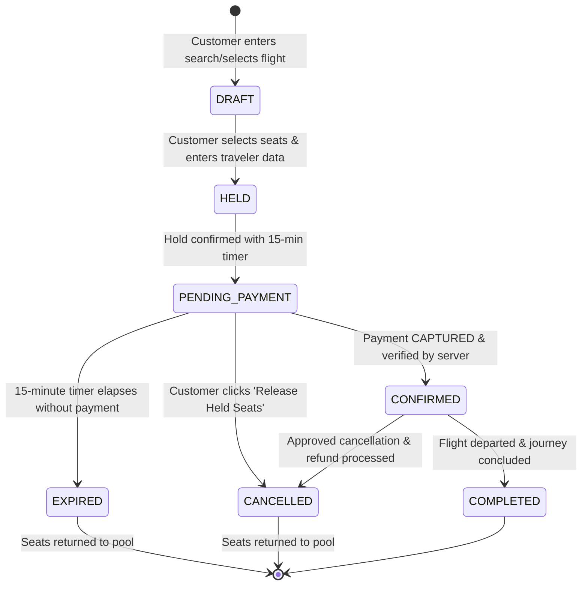
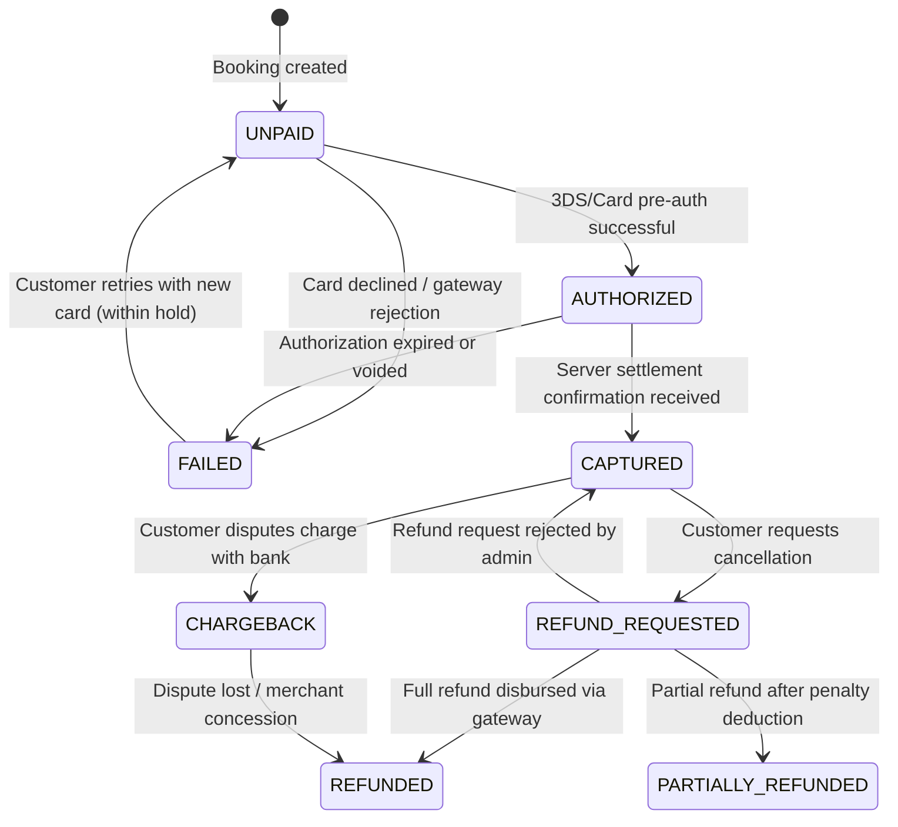
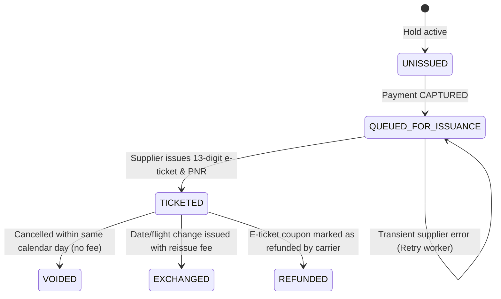
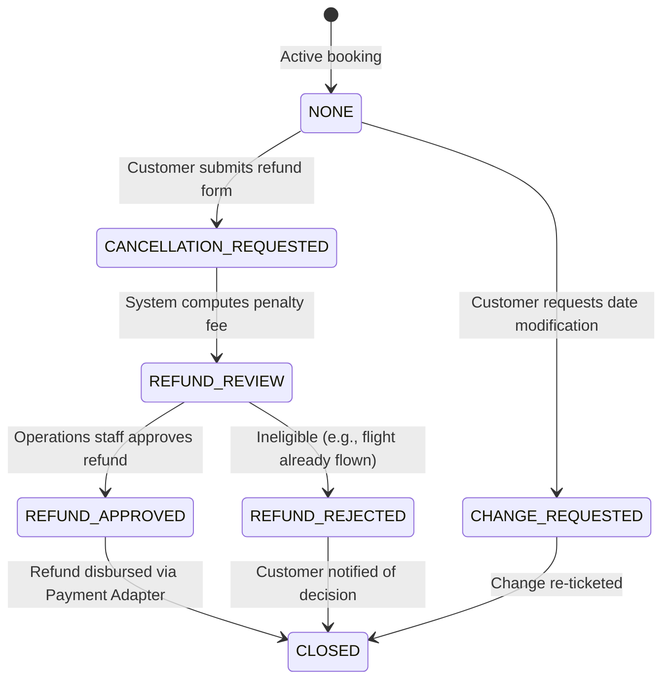

# Booking State Machine Specification

**Project Brand:** FLY Aviation & Travel  
**Author / Engineering Maintainer:** `mahin1710`  
**Document Version:** 1.0.0  
**Status:** Mandatory State Transition Specification

---

## 1. Principles of State Decoupling

A frequent failure mode in flight reservation platforms is collapsing multiple distinct business concepts into a single `status` column (e.g. marking a booking as "PAID" and assuming it is automatically "TICKETED", or marking it "CANCELLED" when only a refund request was filed).

In the FLY platform, **four independent state dimensions** are maintained and decoupled:

1. **Booking Lifecycle State:** Represents the customer journey and seat inventory reservation state.
2. **Payment Lifecycle State:** Represents financial authorization, clearing, settlement, and chargeback states.
3. **Ticket Lifecycle State:** Represents the formal electronic ticket (e-ticket 13-digit number and PNR) status with the airline / supplier.
4. **Servicing Lifecycle State:** Represents post-booking modifications, cancellation reviews, and customer service operations.

---

## 2. State Dimensions & Permitted Values

```
                               ┌─────────────────────────────┐
                               │       BOOKING STATE         │
                               │  - DRAFT                    │
                               │  - HELD (15-min lock)       │
                               │  - PENDING_PAYMENT          │
                               │  - CONFIRMED                │
                               │  - COMPLETED                │
                               │  - EXPIRED                  │
                               │  - CANCELLED                │
                               └──────────────┬──────────────┘
                                              │
              ┌───────────────────────────────┼───────────────────────────────┐
              ▼                               ▼                               ▼
┌───────────────────────────┐   ┌───────────────────────────┐   ┌───────────────────────────┐
│       PAYMENT STATE       │   │       TICKET STATE        │   │      SERVICING STATE      │
│  - UNPAID                 │   │  - UNISSUED               │   │  - NONE                   │
│  - AUTHORIZED             │   │  - QUEUED_FOR_ISSUANCE    │   │  - CHANGE_REQUESTED       │
│  - CAPTURED               │   │  - TICKETED               │   │  - CANCELLATION_REQUESTED │
│  - REFUND_REQUESTED       │   │  - VOIDED                 │   │  - REFUND_REVIEW          │
│  - PARTIALLY_REFUNDED     │   │  - EXCHANGED              │   │  - REFUND_APPROVED        │
│  - REFUNDED               │   │  - REFUNDED               │   │  - REFUND_REJECTED        │
│  - FAILED                 │   └───────────────────────────┘   │  - CLOSED                 │
│  - CHARGEBACK             │                                   └───────────────────────────┘
└───────────────────────────┘
```

---

## 3. Booking Lifecycle State Machine

### Allowed Transitions Diagram



### Transition Rules

| From State | Trigger / Event | To State | Guard Conditions | Side Effects / Actions |
|---|---|---|---|---|
| `DRAFT` | `INITIATE_HOLD` | `HELD` | Seats currently `AVAILABLE`. Flight valid. | Atomic lock acquisition on seats. |
| `HELD` | `CONFIRM_HOLD` | `PENDING_PAYMENT` | All requested seats locked. | `expires_at` set to $t_0 + 15\text{m}$. Timer starts. |
| `PENDING_PAYMENT` | `TIMER_EXPIRED` | `EXPIRED` | `expires_at <= NOW()`. | Seats released to `AVAILABLE`. Customer notified. |
| `PENDING_PAYMENT` | `CUSTOMER_CANCEL` | `CANCELLED` | Customer authenticated. | Seats immediately released to `AVAILABLE`. |
| `PENDING_PAYMENT` | `PAYMENT_CAPTURED` | `CONFIRMED` | Server-side payment verification OK. | Seats set to `BOOKED`. Ticket issuance queued. |
| `CONFIRMED` | `FLIGHT_DEPARTED` | `COMPLETED` | Departure date has passed. | Archival to past bookings. |
| `CONFIRMED` | `CANCELLATION_SETTLED`| `CANCELLED` | Refund approved & processed. | Seats voided. Boarding pass invalidated. |

---

## 4. Payment Lifecycle State Machine

### Allowed Transitions Diagram



### Strict Payment Rule (Rule #6 Compliance)
> **Never mark a booking as PAID or TICKETED from a browser redirect alone.**  
> A browser redirect (e.g. customer returning from a 3D-Secure bank page) can easily be spoofed or intercepted. Payment confirmation is **only** achieved when the payment gateway's signed server-to-server webhook or verified status API returns explicit clearance (`CAPTURED`).

---

## 5. Ticket Lifecycle State Machine



---

## 6. Servicing Lifecycle State Machine



---

## 7. Edge Cases & Recovery Workflows

### 7.1. Payment Captured but Ticketing Timeout (`PAID_AWAITING_TICKETING`)
- **Condition:** Payment is `CAPTURED`, but the supplier ticketing call times out or returns an unexpected error.
- **System Action:**
  1. Booking status remains `CONFIRMED` in customer view, but ticketing status is set to `QUEUED_FOR_ISSUANCE`.
  2. The background ticketing worker retries the supplier issuance 3 times with exponential backoff ($5\text{s}$, $25\text{s}$, $125\text{s}$).
  3. If all retries fail, an operational incident alert is generated for the Airline Admin / Super Admin console.
  4. The customer is shown: *"Payment received! Your e-ticket is being generated by the airline and will appear shortly."*
  5. The customer's payment is **never** left unrecorded or silently discarded.

### 7.2. Payment Completes After 15-Minute Expiration (Race Condition)
- **Condition:** Customer took 14 minutes and 50 seconds to complete bank OTP, and by the time the gateway callback arrives, the 15-minute hold timer expired.
- **System Action:**
  1. Server checks if the held seats are still unassigned.
  2. If unassigned: System immediately re-locks the seats, marks booking as `CONFIRMED`, and issues ticket.
  3. If another user grabbed the seats in the interim: System logs a `SEAT_LOST_ON_LATE_PAYMENT` event, initiates an **automatic 100% full refund** to the customer's card without penalty, and sends an SMS/Email notification: *"Your session timed out before bank confirmation. A full refund has been automatically initiated to your account."*

### 7.3. Duplicate Callback / Webhook Idempotency
- **Condition:** Gateway sends duplicate webhook calls for the same transaction.
- **System Action:**
  1. Backend looks up `payment_ref` in `bookings`.
  2. If already `CONFIRMED`, returns HTTP `200 OK` immediately without repeating ticket issuance or modifying records.
