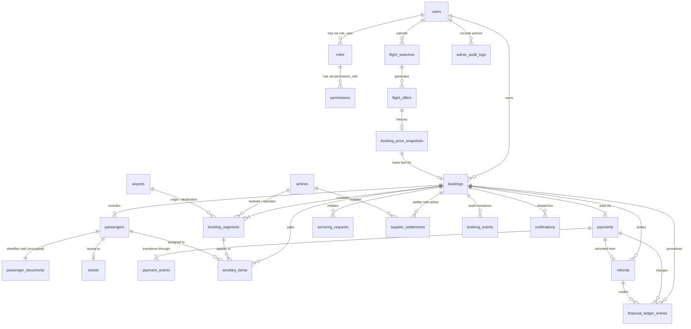

# Database Entity-Relationship Diagram (ERD) & Schema Specification

**Project Brand:** FLY Aviation & Travel  
**Author / Engineering Maintainer:** `mahin1710`  
**Document Version:** 1.0.0  
**Target RDBMS:** PostgreSQL 16+ (Local test compatibility: SQLite WAL)  
**Schema Date:** November 24, 2026

---

## 1. High-Level Entity Relationship Diagram (Mermaid)

---

## 2. Complete Domain Tables & Data Dictionary

### 2.1. Authentication, Identity & Access Control

#### `users`
Primary user table supporting customer, airline admin, and platform super admin accounts.
- `id`: `BIGINT UNSIGNED AUTO_INCREMENT PRIMARY KEY`
- `name`: `VARCHAR(255)`
- `email`: `VARCHAR(255) UNIQUE INDEX`
- `password`: `VARCHAR(255)` (Hashed via Bcrypt / Argon2id)
- `role`: `VARCHAR(30) INDEX` (`customer`, `admin`, `super_admin`)
- `status`: `VARCHAR(30) INDEX` (`active`, `suspended`, `pending_verification`)
- `phone`: `VARCHAR(30) NULLABLE`
- `email_verified_at`: `TIMESTAMP NULLABLE`
- `remember_token`: `VARCHAR(100) NULLABLE`
- `created_at`, `updated_at`: `TIMESTAMP`

#### `roles`
Role dictionary for access privileges.
- `id`: `BIGINT UNSIGNED PRIMARY KEY`
- `name`: `VARCHAR(50) UNIQUE INDEX` (`customer`, `admin`, `airline_admin`, `super_admin`)
- `display_name`: `VARCHAR(100)`
- `description`: `VARCHAR(255) NULLABLE`

#### `permissions`
Granular authorization privileges.
- `id`: `BIGINT UNSIGNED PRIMARY KEY`
- `name`: `VARCHAR(80) UNIQUE INDEX` (`view_bookings`, `manage_flights`, `process_refunds`)
- `display_name`: `VARCHAR(120)`
- `category`: `VARCHAR(50)`

#### `permission_role` & `role_user`
Standard pivot tables managing many-to-many role and permission grants.

---

### 2.2. Geographic & Carrier Master Catalog

#### `airports`
Global airport reference catalog.
- `id`: `BIGINT UNSIGNED PRIMARY KEY`
- `ulid`: `CHAR(26) UNIQUE INDEX`
- `iata_code`: `CHAR(3) UNIQUE INDEX` (`DAC`, `CXB`, `CGP`, `DXB`, `SIN`)
- `icao_code`: `CHAR(4) NULLABLE INDEX` (`VGHS`, `VGCB`, `OMDB`)
- `name`: `VARCHAR(150)`
- `city`: `VARCHAR(100) INDEX`
- `country_code`: `CHAR(2) INDEX` (`BD`, `AE`, `SG`)
- `timezone`: `VARCHAR(50)` (`Asia/Dhaka`, `Asia/Dubai`)
- `latitude`: `DECIMAL(10, 7) NULLABLE`
- `longitude`: `DECIMAL(10, 7) NULLABLE`
- `is_active`: `BOOLEAN INDEX`

#### `airlines`
Aviation operating and marketing carriers.
- `id`: `BIGINT UNSIGNED PRIMARY KEY`
- `ulid`: `CHAR(26) UNIQUE INDEX`
- `iata_code`: `CHAR(2) UNIQUE INDEX` (`BG`, `BS`, `2A`, `EK`)
- `icao_code`: `CHAR(3) NULLABLE INDEX` (`BBC`, `UBG`, `UAE`)
- `name`: `VARCHAR(120)`
- `logo_symbol`: `VARCHAR(100) NULLABLE`
- `country_code`: `CHAR(2) DEFAULT 'BD'`
- `is_active`: `BOOLEAN INDEX`

---

### 2.3. Search, Catalog & Pricing Snapshots

#### `flight_searches`
Customer search sessions with traveler category parameters.
- `id`: `BIGINT UNSIGNED PRIMARY KEY`
- `uuid`: `CHAR(36) UNIQUE INDEX`
- `user_id`: `BIGINT UNSIGNED NULLABLE FOREIGN KEY -> users(id)`
- `trip_type`: `VARCHAR(30)` (`one_way`, `round_trip`, `multi_city`)
- `cabin_class`: `VARCHAR(30)` (`economy`, `premium_economy`, `business`, `first`)
- `adults_count`: `SMALLINT UNSIGNED DEFAULT 1`
- `children_count`: `SMALLINT UNSIGNED DEFAULT 0`
- `infants_count`: `SMALLINT UNSIGNED DEFAULT 0`
- `search_params`: `JSON / JSONB`
- `ip_address`: `VARCHAR(45) NULLABLE`

#### `flight_offers`
Normalized flight itineraries returned by search or provider adapters.
- `id`: `BIGINT UNSIGNED PRIMARY KEY`
- `uuid`: `CHAR(36) UNIQUE INDEX`
- `flight_search_id`: `BIGINT UNSIGNED NULLABLE FOREIGN KEY -> flight_searches(id)`
- `provider_code`: `VARCHAR(50) INDEX` (`DEMO_FIXTURE`, `AMADEUS`, `SABRE`)
- `provider_offer_ref`: `VARCHAR(120) INDEX`
- `fare_family`: `VARCHAR(80)`
- `is_refundable`: `BOOLEAN INDEX`
- `is_bookable`: `BOOLEAN DEFAULT FALSE` (Typed safety guarantee)
- `currency`: `CHAR(3) DEFAULT 'BDT'`
- `base_amount`: `DECIMAL(12, 2)`
- `tax_amount`: `DECIMAL(12, 2)`
- `fee_amount`: `DECIMAL(12, 2)`
- `total_amount`: `DECIMAL(12, 2) INDEX`
- `stops_count`: `SMALLINT UNSIGNED INDEX`
- `duration_minutes`: `INTEGER UNSIGNED`
- `expires_at`: `TIMESTAMP INDEX`
- `raw_payload`: `JSON / JSONB NULLABLE`
- `deleted_at`: `TIMESTAMP NULLABLE` (Soft deletes allowed)

#### `booking_price_snapshots`
Immutable pre-checkout price audit snapshot.
- `id`: `BIGINT UNSIGNED PRIMARY KEY`
- `ulid`: `CHAR(26) UNIQUE INDEX`
- `flight_offer_id`: `BIGINT UNSIGNED NULLABLE FOREIGN KEY -> flight_offers(id)`
- `currency`: `CHAR(3) DEFAULT 'BDT'`
- `base_fare`: `DECIMAL(12, 2)`
- `taxes`: `DECIMAL(12, 2)`
- `airline_fees`: `DECIMAL(12, 2)`
- `service_fees`: `DECIMAL(12, 2)`
- `ancillaries_total`: `DECIMAL(12, 2)`
- `discounts_total`: `DECIMAL(12, 2)`
- `grand_total`: `DECIMAL(12, 2)`
- `breakdown_payload`: `JSON / JSONB`
- `created_at`: `TIMESTAMP` (Immutable snapshot)

---

### 2.4. Core Booking & Itinerary Execution

#### `bookings`
Central booking root entity maintaining four decoupled lifecycle state machines.
- `id`: `BIGINT UNSIGNED PRIMARY KEY`
- `ulid`: `CHAR(26) UNIQUE INDEX`
- `reference`: `VARCHAR(30) UNIQUE INDEX` (`FLY-2026-XXXX`)
- `user_id`: `BIGINT UNSIGNED FOREIGN KEY -> users(id)`
- `booking_price_snapshot_id`: `BIGINT UNSIGNED NULLABLE FOREIGN KEY -> booking_price_snapshots(id)`
- **State Machine Dimensions:**
  - `booking_status`: `VARCHAR(30) INDEX` (`draft`, `held`, `pending_payment`, `confirmed`, `completed`, `expired`, `cancelled`)
  - `payment_status`: `VARCHAR(30) INDEX` (`unpaid`, `authorized`, `captured`, `refund_requested`, `partially_refunded`, `refunded`, `failed`, `chargeback`)
  - `ticket_status`: `VARCHAR(30) INDEX` (`unissued`, `queued_for_issuance`, `ticketed`, `voided`, `exchanged`, `refunded`)
  - `servicing_status`: `VARCHAR(30) INDEX` (`none`, `change_requested`, `cancellation_requested`, `refund_review`, `refund_approved`, `refund_rejected`, `closed`)
- `hold_expires_at`: `TIMESTAMP NULLABLE INDEX` (15-minute seat lock)
- `currency`: `CHAR(3) DEFAULT 'BDT'`
- `total_amount`: `DECIMAL(12, 2)`
- `contact_email`: `VARCHAR(150)`
- `contact_phone`: `VARCHAR(30)`
- `contact_country_code`: `VARCHAR(10) DEFAULT '+880'`
- `airline_pnr`: `VARCHAR(20) NULLABLE INDEX`
- `provider_booking_ref`: `VARCHAR(100) NULLABLE` (Hidden from serialization)
- `remarks`: `TEXT NULLABLE`
- `deleted_at`: `TIMESTAMP NULLABLE` (Soft deletes allowed)

#### `booking_segments`
Flight journey legs preserving both UTC instants and local timezone context.
- `id`: `BIGINT UNSIGNED PRIMARY KEY`
- `ulid`: `CHAR(26) UNIQUE INDEX`
- `booking_id`: `BIGINT UNSIGNED FOREIGN KEY -> bookings(id)`
- `segment_order`: `SMALLINT UNSIGNED` (1, 2, 3...)
- `marketing_airline_id`: `BIGINT UNSIGNED FOREIGN KEY -> airlines(id)`
- `operating_airline_id`: `BIGINT UNSIGNED FOREIGN KEY -> airlines(id)`
- `flight_number`: `VARCHAR(20)` (`BG-433`, `BS-141`)
- `aircraft_type`: `VARCHAR(80) NULLABLE` (`Boeing 737-800`, `ATR 72-600`)
- `origin_airport_id`: `BIGINT UNSIGNED FOREIGN KEY -> airports(id)`
- `destination_airport_id`: `BIGINT UNSIGNED FOREIGN KEY -> airports(id)`
- `departure_time_utc`: `TIMESTAMP INDEX`
- `departure_local_time`: `VARCHAR(40)`
- `departure_timezone`: `VARCHAR(50) DEFAULT 'Asia/Dhaka'`
- `arrival_time_utc`: `TIMESTAMP INDEX`
- `arrival_local_time`: `VARCHAR(40)`
- `arrival_timezone`: `VARCHAR(50) DEFAULT 'Asia/Dhaka'`
- `departure_terminal`: `VARCHAR(40) NULLABLE`
- `arrival_terminal`: `VARCHAR(40) NULLABLE`
- `duration_minutes`: `INTEGER UNSIGNED`
- `layover_minutes`: `INTEGER UNSIGNED DEFAULT 0`
- `cabin_class`: `VARCHAR(30) DEFAULT 'Economy'`
- `booking_class`: `CHAR(2) NULLABLE`
- `status`: `VARCHAR(30) DEFAULT 'confirmed'`

#### `passengers`
Travelers associated with the booking.
- `id`: `BIGINT UNSIGNED PRIMARY KEY`
- `ulid`: `CHAR(26) UNIQUE INDEX`
- `booking_id`: `BIGINT UNSIGNED FOREIGN KEY -> bookings(id)`
- `type`: `VARCHAR(20) INDEX` (`adult`, `child`, `infant`)
- `title`: `VARCHAR(20)` (`MR`, `MS`, `MRS`, `DR`, `MSTR`, `INF`)
- `first_name`: `VARCHAR(100)`
- `last_name`: `VARCHAR(100)`
- `date_of_birth`: `DATE`
- `gender`: `VARCHAR(20) NULLABLE`
- `nationality`: `CHAR(2) DEFAULT 'BD'`
- `wheelchair_required`: `BOOLEAN DEFAULT FALSE`

#### `passenger_documents`
Government-issued travel credentials.
- `id`: `BIGINT UNSIGNED PRIMARY KEY`
- `ulid`: `CHAR(26) UNIQUE INDEX`
- `passenger_id`: `BIGINT UNSIGNED FOREIGN KEY -> passengers(id)`
- `document_type`: `VARCHAR(30) INDEX` (`passport`, `national_id`, `birth_certificate`)
- **`document_number`**: `TEXT` (**Encrypted at rest via AES-256-CBC, strictly hidden from JSON serialization**)
- `document_number_masked`: `VARCHAR(30)` (`A098****`)
- `issuing_country`: `CHAR(2) DEFAULT 'BD'`
- `expiry_date`: `DATE NULLABLE`
- `date_of_birth`: `DATE NULLABLE`

---

### 2.5. Payments, Tickets & Ancillaries

#### `payments`
Immutable financial transaction ledger records.
- `id`: `BIGINT UNSIGNED PRIMARY KEY`
- `ulid`: `CHAR(26) UNIQUE INDEX`
- `booking_id`: `BIGINT UNSIGNED FOREIGN KEY -> bookings(id)`
- `user_id`: `BIGINT UNSIGNED NULLABLE FOREIGN KEY -> users(id)`
- `payment_method`: `VARCHAR(30)` (`card`, `bkash`, `nagad`, `bank_transfer`, `instant_verify`)
- `gateway_provider`: `VARCHAR(40)` (`sslcommerz`, `bkash`, `stripe`, `simulated`)
- `gateway_transaction_id`: `VARCHAR(100) NULLABLE INDEX`
- `gateway_reference`: `VARCHAR(100) NULLABLE`
- `currency`: `CHAR(3) DEFAULT 'BDT'`
- `amount`: `DECIMAL(12, 2)`
- `status`: `VARCHAR(30) INDEX` (`initiated`, `authorized`, `captured`, `refunded`, `failed`)
- `card_last_four`: `CHAR(4) NULLABLE`
- `card_brand`: `VARCHAR(30) NULLABLE`
- `idempotency_key`: `VARCHAR(100) UNIQUE INDEX`
- `gateway_response_payload`: `JSON / JSONB NULLABLE` (Hidden from serialization)
- `authorized_at`: `TIMESTAMP NULLABLE`
- `captured_at`: `TIMESTAMP NULLABLE`
- *(NO SOFT DELETES)*

#### `payment_events`
Append-only payment lifecycle audit stream.
- `id`: `BIGINT UNSIGNED PRIMARY KEY`
- `payment_id`: `BIGINT UNSIGNED FOREIGN KEY -> payments(id)`
- `event_type`: `VARCHAR(60) INDEX`
- `status_from`: `VARCHAR(30) NULLABLE`
- `status_to`: `VARCHAR(30)`
- `payload`: `JSON / JSONB NULLABLE`
- `recorded_at`: `TIMESTAMP DEFAULT CURRENT_TIMESTAMP`
- *(NO SOFT DELETES)*

#### `tickets`
Airline electronic ticket records.
- `id`: `BIGINT UNSIGNED PRIMARY KEY`
- `ulid`: `CHAR(26) UNIQUE INDEX`
- `booking_id`: `BIGINT UNSIGNED FOREIGN KEY -> bookings(id)`
- `passenger_id`: `BIGINT UNSIGNED FOREIGN KEY -> passengers(id)`
- `ticket_number`: `VARCHAR(30) NULLABLE UNIQUE INDEX` (13-digit IATA format `098-1234567890`)
- `pnr_reference`: `VARCHAR(20) NULLABLE INDEX`
- `ticket_status`: `VARCHAR(30) INDEX` (`unissued`, `queued`, `issued`, `voided`, `refunded`, `exchanged`)
- `issuing_carrier_id`: `BIGINT UNSIGNED NULLABLE FOREIGN KEY -> airlines(id)`
- `currency`: `CHAR(3) DEFAULT 'BDT'`
- `fare_amount`: `DECIMAL(12, 2)`
- `issued_at`: `TIMESTAMP NULLABLE`
- `validating_airline_code`: `CHAR(2) NULLABLE`
- `digital_coupon_data`: `JSON / JSONB NULLABLE`

#### `ancillary_items`
Optional add-ons (seats, excess baggage, meals, insurance).
- `id`: `BIGINT UNSIGNED PRIMARY KEY`
- `ulid`: `CHAR(26) UNIQUE INDEX`
- `booking_id`: `BIGINT UNSIGNED FOREIGN KEY -> bookings(id)`
- `passenger_id`: `BIGINT UNSIGNED NULLABLE FOREIGN KEY -> passengers(id)`
- `booking_segment_id`: `BIGINT UNSIGNED NULLABLE FOREIGN KEY -> booking_segments(id)`
- `type`: `VARCHAR(30) INDEX` (`seat`, `baggage`, `meal`, `insurance`, `lounge`)
- `item_code`: `VARCHAR(50)`
- `name`: `VARCHAR(120)`
- `currency`: `CHAR(3) DEFAULT 'BDT'`
- `unit_price`: `DECIMAL(12, 2)`
- `quantity`: `SMALLINT UNSIGNED DEFAULT 1`
- `total_price`: `DECIMAL(12, 2)`
- `status`: `VARCHAR(30) DEFAULT 'reserved' INDEX`
- `details`: `JSON / JSONB NULLABLE`

---

### 2.6. Servicing, Refunds & Financial Ledger

#### `servicing_requests`
Customer modification and cancellation workflows.
- `id`: `BIGINT UNSIGNED PRIMARY KEY`
- `ulid`: `CHAR(26) UNIQUE INDEX`
- `booking_id`: `BIGINT UNSIGNED FOREIGN KEY -> bookings(id)`
- `user_id`: `BIGINT UNSIGNED FOREIGN KEY -> users(id)`
- `request_type`: `VARCHAR(40) INDEX` (`date_change`, `passenger_cancellation`, `special_assistance`, `refund`)
- `status`: `VARCHAR(30) DEFAULT 'pending_review' INDEX`
- `customer_remarks`: `TEXT NULLABLE`
- `agent_notes`: `TEXT NULLABLE`
- `assigned_agent_id`: `BIGINT UNSIGNED NULLABLE FOREIGN KEY -> users(id)`

#### `refunds`
Settled refund calculations.
- `id`: `BIGINT UNSIGNED PRIMARY KEY`
- `ulid`: `CHAR(26) UNIQUE INDEX`
- `booking_id`: `BIGINT UNSIGNED FOREIGN KEY -> bookings(id)`
- `payment_id`: `BIGINT UNSIGNED NULLABLE FOREIGN KEY -> payments(id)`
- `servicing_request_id`: `BIGINT UNSIGNED NULLABLE FOREIGN KEY -> servicing_requests(id)`
- `refund_reference`: `VARCHAR(40) UNIQUE INDEX` (`REF-2026-XXXX`)
- `currency`: `CHAR(3) DEFAULT 'BDT'`
- `gross_amount`: `DECIMAL(12, 2)`
- `airline_penalty_fee`: `DECIMAL(12, 2) DEFAULT 0`
- `service_cancellation_fee`: `DECIMAL(12, 2) DEFAULT 0`
- `net_refund_amount`: `DECIMAL(12, 2)`
- `status`: `VARCHAR(30) DEFAULT 'requested' INDEX`
- `settled_at`: `TIMESTAMP NULLABLE`
- `processed_by_user_id`: `BIGINT UNSIGNED NULLABLE FOREIGN KEY -> users(id)`
- *(NO SOFT DELETES)*

#### `financial_ledger_entries`
Double-entry accounting journal for financial reconciliation.
- `id`: `BIGINT UNSIGNED PRIMARY KEY`
- `ulid`: `CHAR(26) UNIQUE INDEX`
- `booking_id`: `BIGINT UNSIGNED NULLABLE FOREIGN KEY -> bookings(id)`
- `payment_id`: `BIGINT UNSIGNED NULLABLE FOREIGN KEY -> payments(id)`
- `refund_id`: `BIGINT UNSIGNED NULLABLE FOREIGN KEY -> refunds(id)`
- `entry_type`: `VARCHAR(40) INDEX` (`customer_charge`, `supplier_payable`, `agency_commission`, `tax_withholding`, `customer_refund`, `chargeback_debit`)
- `debit_amount`: `DECIMAL(12, 2) DEFAULT 0`
- `credit_amount`: `DECIMAL(12, 2) DEFAULT 0`
- `currency`: `CHAR(3) DEFAULT 'BDT'`
- `description`: `VARCHAR(255)`
- `account_code`: `VARCHAR(50) INDEX`
- `recorded_at`: `TIMESTAMP INDEX`
- *(NO SOFT DELETES)*

#### `supplier_settlements`
Airline supplier accounts payable audit.
- `id`: `BIGINT UNSIGNED PRIMARY KEY`
- `ulid`: `CHAR(26) UNIQUE INDEX`
- `booking_id`: `BIGINT UNSIGNED FOREIGN KEY -> bookings(id)`
- `airline_id`: `BIGINT UNSIGNED FOREIGN KEY -> airlines(id)`
- `provider_name`: `VARCHAR(50)`
- `supplier_invoice_ref`: `VARCHAR(100) NULLABLE INDEX`
- `settlement_currency`: `CHAR(3) DEFAULT 'BDT'`
- `settlement_amount`: `DECIMAL(12, 2)`
- `settlement_status`: `VARCHAR(30) DEFAULT 'pending' INDEX`
- `settled_at`: `TIMESTAMP NULLABLE`
- *(NO SOFT DELETES)*

---

### 2.7. Event Sourcing, Idempotency & Audit Logs

#### `idempotency_records`
Prevents duplicate payment capture or double-hold race conditions.
- `id`: `BIGINT UNSIGNED PRIMARY KEY`
- `idempotency_key`: `VARCHAR(120) UNIQUE INDEX`
- `scope`: `VARCHAR(60) INDEX` (`booking_payment`, `flight_hold`)
- `user_id`: `BIGINT UNSIGNED NULLABLE FOREIGN KEY -> users(id)`
- `request_hash`: `VARCHAR(64)` (SHA-256 hash of payload)
- `response_status_code`: `SMALLINT UNSIGNED`
- `response_body`: `JSON / JSONB`
- `locked_until`: `TIMESTAMP NULLABLE`

#### `booking_events`
Append-only state transition audit trail.
- `id`: `BIGINT UNSIGNED PRIMARY KEY`
- `booking_id`: `BIGINT UNSIGNED FOREIGN KEY -> bookings(id)`
- `event_name`: `VARCHAR(60) INDEX` (`hold_created`, `payment_captured`, `ticket_issued`, `hold_expired`, `cancelled`)
- `status_from`: `VARCHAR(30) NULLABLE`
- `status_to`: `VARCHAR(30)`
- `actor_type`: `VARCHAR(30) DEFAULT 'customer'`
- `actor_id`: `VARCHAR(50) NULLABLE`
- `payload`: `JSON / JSONB NULLABLE`
- `ip_address`: `VARCHAR(45) NULLABLE`
- `recorded_at`: `TIMESTAMP INDEX`
- *(NO SOFT DELETES)*

#### `provider_calls`
Telemetry and API latency log for GDS/NDC and payment provider calls.
- `id`: `BIGINT UNSIGNED PRIMARY KEY`
- `ulid`: `CHAR(26) UNIQUE INDEX`
- `provider_name`: `VARCHAR(50) INDEX` (`AMADEUS`, `SABRE`, `BIMAN_DIRECT`, `BKASH`)
- `endpoint`: `VARCHAR(255)`
- `http_method`: `VARCHAR(10)`
- `status_code`: `SMALLINT UNSIGNED INDEX`
- `duration_ms`: `INTEGER UNSIGNED`
- `request_payload`: `JSON / JSONB NULLABLE` (Sanitized, credentials stripped)
- `response_payload`: `JSON / JSONB NULLABLE`
- `is_error`: `BOOLEAN DEFAULT FALSE INDEX`
- `error_message`: `TEXT NULLABLE`
- *(NO SECRETS STORED)*

#### `notifications`
Customer communication log (email, SMS, WhatsApp).
- `id`: `BIGINT UNSIGNED PRIMARY KEY`
- `ulid`: `CHAR(26) UNIQUE INDEX`
- `booking_id`: `BIGINT UNSIGNED NULLABLE FOREIGN KEY -> bookings(id)`
- `user_id`: `BIGINT UNSIGNED NULLABLE FOREIGN KEY -> users(id)`
- `channel`: `VARCHAR(20) INDEX` (`email`, `sms`, `whatsapp`, `in_app`)
- `recipient`: `VARCHAR(150)`
- `template_name`: `VARCHAR(80)`
- `title`: `VARCHAR(200)`
- `body`: `TEXT`
- `status`: `VARCHAR(30) DEFAULT 'queued' INDEX`
- `sent_at`: `TIMESTAMP NULLABLE`
- `failure_reason`: `VARCHAR(255) NULLABLE`

#### `admin_audit_logs`
Immutable compliance audit log tracking administrative user interventions.
- `id`: `BIGINT UNSIGNED PRIMARY KEY`
- `user_id`: `BIGINT UNSIGNED NULLABLE FOREIGN KEY -> users(id)`
- `action`: `VARCHAR(80) INDEX` (`refund_approved`, `schedule_adjusted`, `user_suspended`)
- `target_type`: `VARCHAR(80) INDEX`
- `target_id`: `VARCHAR(80) INDEX`
- `ip_address`: `VARCHAR(45) NULLABLE`
- `user_agent`: `VARCHAR(255) NULLABLE`
- `before_state`: `JSON / JSONB NULLABLE`
- `after_state`: `JSON / JSONB NULLABLE`
- `created_at`: `TIMESTAMP`
- *(NO SOFT DELETES)*

#### `promotions`
Discount codes and vouchers.
- `id`: `BIGINT UNSIGNED PRIMARY KEY`
- `ulid`: `CHAR(26) UNIQUE INDEX`
- `code`: `VARCHAR(40) UNIQUE INDEX`
- `title`: `VARCHAR(120)`
- `description`: `TEXT NULLABLE`
- `discount_type`: `VARCHAR(20) DEFAULT 'fixed_amount'` (`fixed_amount`, `percentage`)
- `discount_value`: `DECIMAL(10, 2)`
- `currency`: `CHAR(3) DEFAULT 'BDT'`
- `min_spend`: `DECIMAL(12, 2) DEFAULT 0`
- `max_discount`: `DECIMAL(12, 2) NULLABLE`
- `usage_limit`: `INTEGER UNSIGNED NULLABLE`
- `usage_count`: `INTEGER UNSIGNED DEFAULT 0`
- `starts_at`: `TIMESTAMP INDEX`
- `expires_at`: `TIMESTAMP INDEX`
- `is_active`: `BOOLEAN DEFAULT TRUE INDEX`
- `deleted_at`: `TIMESTAMP NULLABLE`
