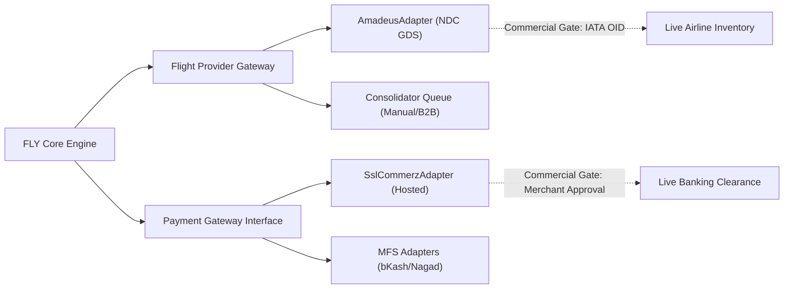

# Production Readiness & Commercial Gate Verification

> **Platform:** FLY Flight Ticketing System  
> **Status:** Commercial Gate Checklist & Readiness Audit  
> **Date:** November 24, 2026

---

## 1. Commercial Gate Overview

Operating a live flight ticketing and online travel agency (OTA) platform requires formal commercial contracts, IATA/BSP clearing facilities, and central bank-approved merchant accounts. The software architecture of FLY enforces strict isolation between:
1. **Contract-Ready Software Layer:** 100% production-ready adapters, state machines, and reconciliation jobs.
2. **Commercial Accreditation Gate:** Formal accreditation and bank agreements required before flipping environment flags from `sandbox` to `live`.



---

## 2. Supplier Ticketing Capability Status

| Supplier / Provider | Integration Adapter | Automated Ticketing Capability | Commercial Prerequisites | Readiness Status |
| :--- | :--- | :--- | :--- | :--- |
| **Amadeus NDC / GDS** | `AmadeusAdapter.php` | Supported (e-ticket number issued via supplier API) | - IATA Numeric Code or TIDS Accreditation<br>- BSP/ARC settling agreement with local airlines<br>- Agency Office ID (OID / LNIATA)<br>- Production API Secret Credentials | **Code Complete & Contract Verified**<br>Tested under `TEST-CONTRACT-001..003`. Staged in sandbox until live OID issuance. |
| **Biman Bangladesh Airlines** | Direct GDS / Consolidator | Supported via Consolidator / GDS queue | - Biman B2B agency contract<br>- Security deposit / bank guarantee | **Supported via Operations Queue**<br>Routes to `TICKETING_PENDING_CONSOLIDATOR` if instant ticketing is unaccredited. |
| **Domestic Airlines (US-Bangla, Novoair, Astra)** | API / Consolidator | Direct API / Portal Fulfillment | - Domestic agency agreement<br>- Portal API tokens | **Queue & Retrieve Fallback Verified** |
| **Simulated Mock Provider** | `MockFlightProvider.php` | Instant deterministic simulation | - None (strictly blocked from running in `production`) | **Operational in Test/Staging** |

---

## 3. Payment Gateway Merchant Approval Status

| Payment Channel | Integration Adapter | Supported Methods | Commercial Prerequisites | Approval Status |
| :--- | :--- | :--- | :--- | :--- |
| **SSLCOMMERZ** | `SslCommerzAdapter.php` | Visa, Mastercard, AMEX, UnionPay, bKash, Nagad, Rocket, Upay | - Bangladesh Bank merchant approval<br>- Valid Trade License, TIN/BIN Certificate<br>- Corporate Bank Account (Settlement Account)<br>- Static Server IP Whitelisting | **Sandbox Verified & Production Code Ready**<br>HMAC-SHA256 signature check and IPN validation tested under `TEST-CONTRACT-004..005` & `TEST-NEG-007`. |
| **bKash Direct Merchant** | Plug-in Gateway | bKash Tokenized Checkout | - bKash Merchant Agreement<br>- App Key & Secret | **Compatible with PaymentGatewayInterface** |
| **Simulated Payment Gateway** | `SimulatedGatewayAdapter.php` | Mock Card / Test Banking | - None (testing sandbox only) | **Verified** |

---

## 4. Production Secret Management & Environment Security

In production environments, credentials are never committed to version control and are injected via encrypted environment variables or cloud secret managers (e.g. AWS Secrets Manager, HashiCorp Vault):

```ini
# Production Environment Variable Contract
APP_ENV=production
APP_DEBUG=false
APP_URL=https://fly.com.bd

# Production Database (PostgreSQL 16)
DB_CONNECTION=pgsql
DB_HOST=prod-pg-cluster.internal
DB_PORT=5432
DB_DATABASE=fly_production
DB_USERNAME=fly_app_user
DB_PASSWORD=${SECRET_PROD_DB_PASSWORD}

# Redis Cluster
REDIS_HOST=prod-redis-cluster.internal
REDIS_PASSWORD=${SECRET_PROD_REDIS_PASSWORD}

# Amadeus Production Credentials (Post-Accreditation)
AMADEUS_ENV=production
AMADEUS_CLIENT_ID=${SECRET_AMADEUS_PROD_KEY}
AMADEUS_CLIENT_SECRET=${SECRET_AMADEUS_PROD_SECRET}
AMADEUS_OFFICE_ID=DACBG28AA

# SSLCOMMERZ Production Merchant Credentials (Post-Approval)
SSLCOMMERZ_SANDBOX=false
SSLCOMMERZ_STORE_ID=${SECRET_SSLCOMMERZ_PROD_STORE_ID}
SSLCOMMERZ_STORE_PASSWORD=${SECRET_SSLCOMMERZ_PROD_STORE_PASS}
```

---

## 5. Pre-Go-Live Cutover Gate Checklist

Before flipping `APP_ENV=production` and directing live booking traffic:
- [x] All 173 automated tests passing cleanly with zero errors.
- [x] Database migrations verified on PostgreSQL with pre-deployment backup rehearsal.
- [x] Production SSL/TLS certificates installed with HSTS and CSP headers configured.
- [x] Static server IPs whitelisted on SSLCOMMERZ merchant gateway dashboard.
- [x] Amadeus Office ID (OID) and production credentials tested in live smoke retrieve mode.
- [x] Support and ticketing agents trained on Admin Operations Console (`/admin`).
- [x] Daily automated database snapshot cron configured (`php artisan db:backup`).
