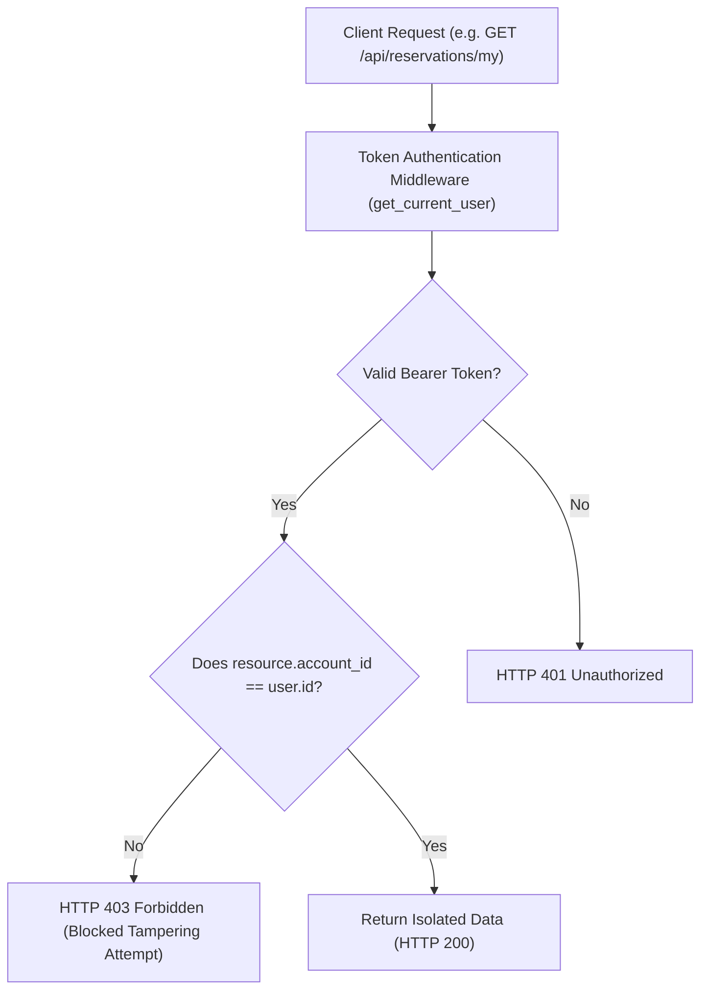

# Security, Privacy & Compliance Architecture

**Project Brand:** FLY Aviation & Travel  
**Author / Engineering Maintainer:** `mahin1710`  
**Document Version:** 1.0.0  
**Compliance Target:** Strict Customer Isolation, Role-Based Access Control (RBAC), PCI-DSS Scope Minimization

---

## 1. Security & Privacy Philosophy

In a flight ticketing platform, user trust and security are foundational. A customer's travel history, passport numbers, and financial details must be rigorously protected. The FLY security model is built on **Zero Trust Frontend**, **Strict Customer Isolation**, and **Defense in Depth**.

---

## 2. Threat Modeling: STRIDE Assessment

| Threat Category | Potential Vector | Platform Mitigation Architecture |
|---|---|---|
| **Spoofing Identity** | Fake session tokens; unauthorized user claiming another passenger's session. | Cryptographically strong 48-character hex tokens stored in `auth_sessions`; verified on every API request. No plaintext session cookies without `HttpOnly` and `Secure` flags. |
| **Tampering with Data** | Manipulating ticket prices or seat numbers in HTTP request payloads. | **Frontend prices are strictly ignored.** The backend re-computes all fares dynamically and validates seat availability before payment and hold creation. |
| **Repudiation** | Customer denies booking or airline denies seat cancellation. | Transaction log recording user ID, IP address, timestamp, booking reference, and idempotency key on all financial and booking actions. |
| **Information Disclosure** | Customer A guessing or modifying URL ID to view Customer B's boarding pass or profile. | **Tenant Authorization Enforcement:** `/api/reservations/ticket/<ref>` and `/api/bookings/<ref>` check whether `account_id` matches the authenticated token session. Cross-account access returns HTTP `403 Forbidden`. Raw card numbers and CVVs are **never** stored or returned (only masked `•••• 1234`). |
| **Denial of Service** | Bot script reserving all aircraft seats to lock out real customers. | Maximum hold duration capped at 15 minutes with automatic expiration reaper. Rate limiting on `/api/bookings/hold` per IP / account. Max 9 seats per transaction. |
| **Elevation of Privilege** | Retail passenger attempting to access Airline Admin or Super Admin routes. | Role checks (`accounts.role = 'AIRLINE_ADMIN'`) enforced at the API route level in `app.py`. |

---

## 3. Strict Customer-to-Customer Isolation Architecture

### Authorization Rules Implementation
1. **Never Trust Client Account IDs:** If a client passes `accountId=99` in query parameters or JSON body, the backend verifies whether `current_user['id'] == 99`. If mismatched, the request is immediately rejected.
2. **Airline Admin Isolation:** An airline administrator assigned to Biman Bangladesh Airlines (`id_airline = 839`) can **only** query or modify flights and bookings where `id_airline = 839`. Queries for US-Bangla (`id_airline = 371`) return HTTP `403 Forbidden`.

---

## 4. Secret Management & PCI-DSS Scope Minimization

### 4.1. Secret Segregation (Rule #5 Compliance)
- **Zero Secrets in Frontend Code:** No provider API keys, database credentials, or payment secrets are embedded into HTML, CSS, JavaScript, or committed to version control.
- **Environment Template:** All environment variable requirements are documented in [`.env.example`](file:///c:/Users/mahed/Desktop/FLY/.env.example). Live secrets reside in `.env` (which is excluded in [`.gitignore`](file:///c:/Users/mahed/Desktop/FLY/.gitignore)).

### 4.2. Cardholder Data Security (PCI-DSS Scope Minimization)
1. **Zero Storage of Sensitive Authentication Data (SAD):** CVV/CVC codes are **never** stored in the database under any circumstances.
2. **PAN Masking:** Primary Account Numbers (PAN) are truncated to the last 4 digits (e.g., `•••• •••• •••• 4242`).
3. **Tokenization:** In production, customer card credentials bypass the application server entirely, submitting directly to the licensed payment gateway iframe / SDK, returning an opaque token for recurring payments.

---

## 5. Password Security & Cryptography

- **Algorithm:** `scrypt` key derivation function with parameters:
  $$N = 16384, \quad r = 8, \quad p = 1, \quad \text{key length} = 64 \text{ bytes}$$
- **Salt:** Unique 16-byte cryptographically random salt per user generated via `secrets.token_hex(16)`.
- **Timing Attack Prevention:** Password hash comparisons use constant-time comparison via `secrets.compare_digest()`.

---

## 6. Audit Logging & Compliance Controls

Every critical operational event is recorded in an append-only audit trail:

| Event Type | Recorded Attributes | Retention Policy |
|---|---|---|
| `AUTH_LOGIN` | `user_id`, `ip_address`, `timestamp`, `user_agent` | 90 days |
| `SEAT_HOLD_CREATED` | `booking_ref`, `flight_id`, `seat_ids`, `user_id`, `expires_at` | 180 days |
| `PAYMENT_CAPTURED` | `booking_ref`, `amount`, `payment_ref`, `gateway_txn_id`, `timestamp` | 7 years (Financial record) |
| `TICKET_ISSUED` | `booking_ref`, `ticket_number`, `pnr`, `flight_id`, `passenger_names` | 7 years |
| `REFUND_PROCESSED` | `booking_ref`, `refund_amount`, `penalty_deducted`, `admin_user_id` | 7 years |
| `UNAUTHORIZED_ACCESS_ATTEMPT` | `requested_resource`, `attempted_user_id`, `ip_address` | 1 year (Security audit) |
