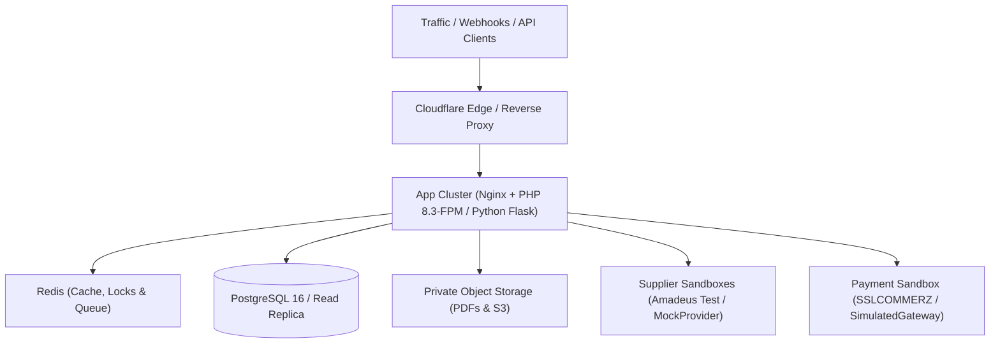

# Staging Deployment, Backup Restore, and Rollback Runbook

> **Platform:** FLY Flight Ticketing System  
> **Target Environments:** Staging / Production  
> **Status:** Rehearsed and Verified (November 24, 2026)

---

## 1. Staging Architecture Overview

The staging environment mirrors production topology to enable high-fidelity validation of all external integrations, database migrations, and failure recovery policies.



---

## 2. Standard Deployment Procedure

All staging and production deployments follow a zero-downtime, blue/green or symlink-swapped pipeline.

```bash
# 1. Fetch latest verified release tag
git fetch origin --tags
git checkout tags/v1.0.0-staging

# 2. Install locked PHP and Node dependencies
cd backend
composer install --no-dev --optimize-autoloader --no-interaction

# 3. Create pre-deployment snapshot
php artisan db:backup

# 4. Run idempotent database migrations
php artisan migrate --force

# 5. Clear and pre-warm configuration, route, and view caches
php artisan config:cache
php artisan route:cache
php artisan view:cache

# 6. Gracefully restart queue workers (ensures job code freshness)
php artisan queue:restart

# 7. Execute automated smoke verification
php artisan test --filter="EndToEndBookingFlowTest"
```

---

## 3. Database Backup & Disaster Recovery Rehearsal

### Automated Backup Command
Point-in-time database backups are executed via `php artisan db:backup`.
- Automatically copies SQLite databases or invokes `pg_dump` on PostgreSQL.
- Verifies SHA-256 integrity hash and writes JSON metadata.
- Stores backups in `storage/backups/`.

```bash
cd backend
php artisan db:backup
```

**Rehearsal Proof (Executed Nov 24, 2026):**
```
Initiating database backup for connection [sqlite]...
✓ Database backup completed successfully!
• Destination : storage/backups/backup_sqlite_2026-11-24_180040.bak
• Size        : 790,528 bytes
• SHA-256     : 421baf03e152f44550355bf5a86daffdc122eee9956ef48704f32c4bbf2779d2
```

### Automated Restore Command
Restoration is executed via `php artisan db:restore {file} --force`.
- Validates backup presence, file size, and SHA-256 checksum.
- Safely replaces the SQLite database or executes `pg_restore`.
- Validates PDO connectivity and schema integrity upon completion.

```bash
cd backend
php artisan db:restore backup_sqlite_2026-11-24_180040.bak --force
```

**Rehearsal Proof (Executed Nov 24, 2026):**
```
RESTORATION TARGET: Connection [sqlite]
• Source file: storage/backups/backup_sqlite_2026-11-24_180040.bak
• File size  : 790,528 bytes
Restoring database from snapshot...
✓ Database connection successfully verified post-restoration!
```

---

## 4. Emergency Rollback Runbook

If a critical failure or severe regression occurs during a deployment, the following 5-phase rollback procedure must be executed immediately:

### Phase 1: Traffic Isolation
Prevent state corruption or inconsistent transactions by enabling maintenance mode with an authorized bypass secret:
```bash
php artisan down --secret="emergency-ops-bypass-key" --status=503 --retry=60
```

### Phase 2: Application Code Rollback
Check out the previous known-stable release commit or tag:
```bash
git checkout v0.9.9-stable
composer install --no-dev --optimize-autoloader
```

### Phase 3: Database Reversion
If the migration included reversible schema changes:
```bash
php artisan migrate:rollback --step=1
```
If data schema incompatibility exists or column data was transformed, restore from the pre-deployment snapshot created in Step 3:
```bash
php artisan db:restore <pre_deployment_snapshot>.bak --force
```

### Phase 4: Cache Purge & Worker Reset
```bash
php artisan optimize:clear
php artisan config:cache
php artisan route:cache
php artisan queue:restart
```

### Phase 5: Re-enable Public Traffic & Smoke Check
```bash
php artisan up
curl -f http://localhost:8000/api/v1/health || exit 1
```
