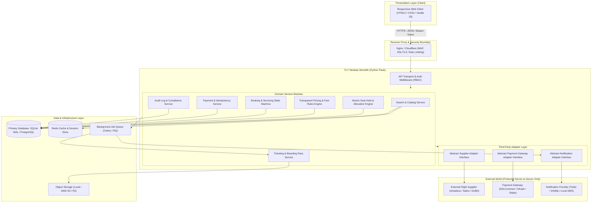
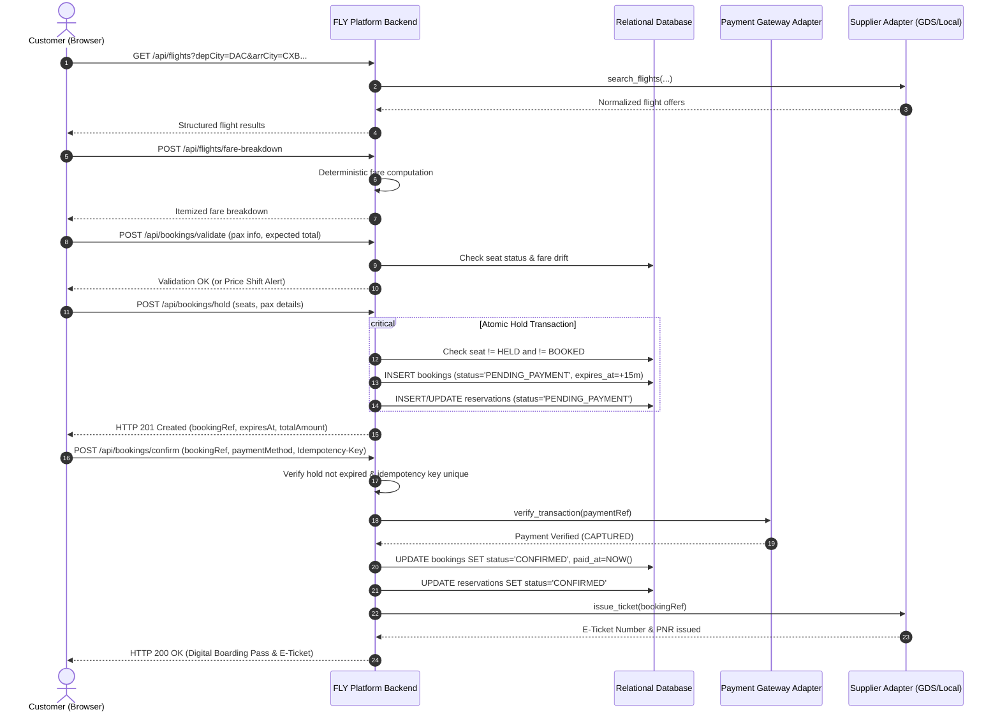

# System Architecture Document: Flight Ticketing Platform

**Project Brand:** FLY Aviation & Travel  
**Author / Engineering Maintainer:** `mahin1710`  
**Document Version:** 1.0.0  
**Architectural Style:** Modular Monolith  
**Primary Language / Framework:** Python (Flask) / SQLite (Dev) $\rightarrow$ PostgreSQL (Prod)

---

## 1. Architectural Philosophy: The Modular Monolith

Rather than introducing distributed microservices with complex network boundaries, eventual consistency failures, and high deployment overhead, the FLY platform is architected as a **Modular Monolith**.

### Core Tenets
1. **In-Process Module Boundaries:** Business domains (Search, Pricing, Inventory/Hold, Payment, Ticketing, Servicing) communicate via clean in-memory interfaces and strongly-typed contracts, not slow HTTP microservice calls.
2. **Single Primary Database with Domain Boundaries:** A centralized relational schema with strict foreign keys and transactional guarantees, avoiding dual-write and distributed transaction (2PC/Saga) complexity.
3. **Decoupled Asynchronous Tasks:** Long-running I/O (supplier GDS ticketing, payment webhook processing, email/SMS dispatch) is dispatched via an asynchronous job queue (Redis + Celery/RQ or background threading).
4. **Adapter Pattern for Third Parties:** All external suppliers (GDS, NDC, payment gateways) are accessed through normalized internal interfaces, isolating external API changes from core business logic.

---

## 2. System Component Diagram



---

## 3. Layer Boundaries & Responsibilities

### 3.1. Presentation Layer (Client)
- **Files:** [`templates/index.html`](file:///c:/Users/mahed/Desktop/FLY/templates/index.html), [`static/css/style.css`](file:///c:/Users/mahed/Desktop/FLY/static/css/style.css), [`static/js/app.js`](file:///c:/Users/mahed/Desktop/FLY/static/js/app.js).
- **Technology:** Vanilla JavaScript (ES6+), HTML5, CSS3 with responsive CSS variables.
- **Responsibilities:** DOM rendering, form validation, autocomplete suggestions, sticky countdown timers, seat map SVG interaction.
- **Strict Rule:** **The client NEVER touches external provider secrets or payment gateway credentials directly.** All third-party interactions route through the Python Flask backend.

### 3.2. API & Transport Layer
- **Files:** [`app.py`](file:///c:/Users/mahed/Desktop/FLY/app.py).
- **Responsibilities:**
  - HTTP routing, parameter parsing, request sanitation.
  - Authentication verification (`Authorization: Bearer <token>` in `auth_sessions`).
  - Tenant and Role-Based Access Control (`PASSENGER` vs. `AIRLINE_ADMIN`).
  - Response formatting (standardized JSON structures with error codes).

### 3.3. Domain Services Layer
- **Search & Catalog Service:** Evaluates route requests, applies cabin class multipliers, checks origin/destination pairs, caches flight listings.
- **Pricing & Fare Rules Engine:** Server-side deterministic breakdown:
  $$\text{Total} = \text{Base} + \text{VAT (15\%)} + \text{Embarkation (৳500)} + \text{Fuel (৳300)} + \text{Baggage} - \text{Discount}$$
  Calculates child/infant discounts based on IATA rules ($75\%$ base for children, $10\%$ base for lap infants).
- **Seat Engine & 15-Minute Hold:** Executes serialized, atomic seat reservation transactions. Implements conflict-safe checks and TTL expiration reapers.
- **Booking State Machine:** Strictly enforces valid transitions across Booking, Payment, Ticket, and Servicing statuses.
- **Payment & Idempotency Service:** Validates payment tokens, prevents duplicate charge processing via unique transaction references, and verifies server-to-server gateway callbacks.
- **Ticketing & Boarding Pass Service:** Generates unique PNRs, ticket numbers, gate/terminal allocations, and printable e-tickets.
- **Audit Service:** Records append-only audit trail entries for state transitions and administrative operations.

### 3.4. Data Persistence & Cache Boundaries
- **Current Database (Dev):** SQLite (`database/flight_booking.db`) operated in WAL mode for local high concurrency.
- **Production Migration Target:** PostgreSQL 16+ using connection pooling (PgBouncer) and row-level locking (`SELECT ... FOR UPDATE` for seat holds).
- **Cache Boundary:** Redis (in-memory, TTL = 300 seconds for flight searches, key format: `search:v1:<dep>:<arr>:<date>:<cabin>:<pax>`).
- **Queue Boundary:** Redis + Celery / RQ for decoupled asynchronous execution:
  - Supplier ticket issuance dispatch.
  - Seat hold expiration sweepers (scheduled every 60 seconds).
  - Customer email/SMS e-ticket dispatch.

---

## 4. External Integration Adapter Pattern

To protect against vendor lock-in and adhere to architectural rules, all external integrations use abstract adapter interfaces:

### 4.1. Flight Supplier Adapter Interface
```python
from abc import ABC, abstractmethod
from typing import List, Dict, Any

class FlightSupplierAdapter(ABC):
    """Normalized interface for all flight inventory providers."""

    @abstractmethod
    def search_flights(self, origin: str, destination: str, date: str, passengers: Dict[str, int], cabin: str) -> List[Dict[str, Any]]:
        """Searches availability and returns normalized flight offers."""
        pass

    @abstractmethod
    def create_seat_hold(self, flight_id: str, seat_ids: List[str], passenger_data: List[Dict[str, Any]], hold_duration_seconds: int = 900) -> Dict[str, Any]:
        """Creates a temporary PNR or hold on the provider side."""
        pass

    @abstractmethod
    def issue_ticket(self, booking_reference: str, payment_reference: str) -> Dict[str, Any]:
        """Requests formal electronic ticket issuance from the supplier."""
        pass

    @abstractmethod
    def cancel_reservation(self, booking_reference: str) -> bool:
        """Cancels a pending or confirmed booking on provider side."""
        pass
```

- **Implementations:**
  1. `DatabaseDemoSupplier`: Interacts with internal SQLite/PostgreSQL inventory (active for local development and demos).
  2. `AmadeusGDSAdapter`: Production GDS integration (to be activated upon commercial contract).
  3. `DuffelNDCAdapter`: Production direct airline NDC integration.

### 4.2. Payment Gateway Adapter Interface
```python
class PaymentGatewayAdapter(ABC):
    """Normalized interface for merchant payment gateways."""

    @abstractmethod
    def initiate_payment(self, booking_ref: str, amount: float, currency: str, customer_info: Dict[str, Any]) -> Dict[str, Any]:
        """Generates checkout session or gateway redirect URL."""
        pass

    @abstractmethod
    def verify_transaction(self, gateway_transaction_id: str, server_signature: str) -> Dict[str, Any]:
        """Verifies trusted server-to-server payment status."""
        pass

    @abstractmethod
    def process_refund(self, original_transaction_id: str, refund_amount: float, reason: str) -> Dict[str, Any]:
        """Dispatches an electronic refund to customer's source account."""
        pass
```

---

## 5. End-to-End Booking Sequence Diagram



---

## 6. Concurrency, Idempotency & Fault Tolerance

### 6.1. Atomic Seat Locking & Concurrency Control
- **Concurrency Problem:** Two users simultaneously click "Hold Seat" on Seat 12A.
- **Resolution Strategy:**
  1. *SQLite (Development):* Single-writer WAL mode within an immediate transaction (`BEGIN IMMEDIATE`). Checks for active holds before updating.
  2. *PostgreSQL (Production):* Row-level locking:
     ```sql
     SELECT id, status FROM seats WHERE id IN (:seat_ids) FOR UPDATE;
     ```
  3. If any seat has `status = 'HELD'` (where `expires_at > NOW()`) or `status = 'CONFIRMED'`, the transaction immediately rolls back and returns HTTP `409 Conflict`.

### 6.2. Idempotent Payment & Confirmation
- Every payment confirmation request includes an idempotency token:
  `Idempotency-Key: TXN-<timestamp>-<hash>`
- When received:
  1. If booking is already `CONFIRMED`, backend skips payment processing and returns the existing digital boarding pass immediately.
  2. If the request is currently being processed by another worker, subsequent requests block or return HTTP `409 In Progress`.

### 6.3. Failure Recovery & Expiration Reapers
- **Expired Hold Reaper:** Background job running every 60 seconds executes:
  ```sql
  UPDATE bookings SET status = 'EXPIRED' WHERE status = 'PENDING_PAYMENT' AND expires_at <= NOW();
  UPDATE reservations SET status = 'EXPIRED' WHERE status = 'PENDING_PAYMENT' AND expires_at <= NOW();
  ```
- **Payment Success but Supplier Ticketing Failure:**
  - If payment succeeds but the supplier call times out, the booking enters `PAID_AWAITING_TICKETING`.
  - A retry queue attempts ticketing 3 times with exponential backoff ($5\text{s}$, $25\text{s}$, $125\text{s}$).
  - If still unresolved, an operational alert is created for manual administrative intervention. The customer's funds are never silently abandoned.
